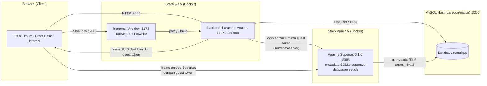
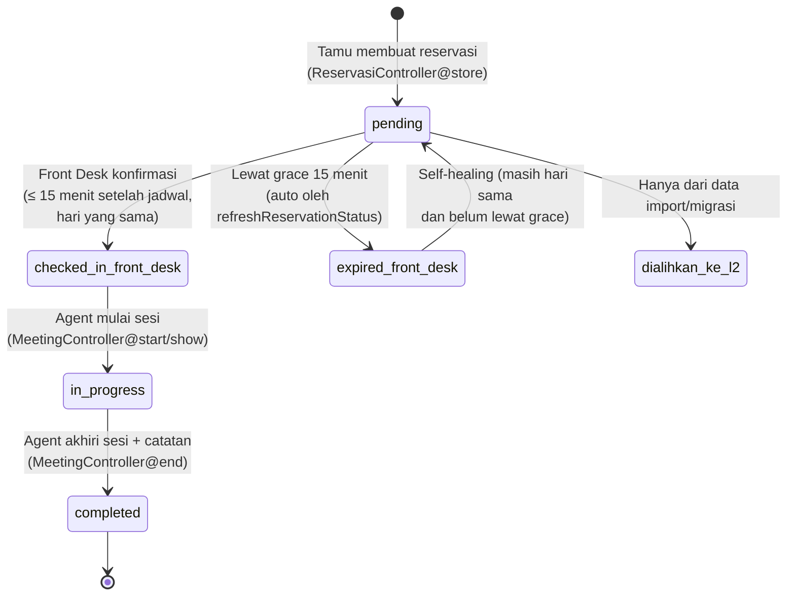
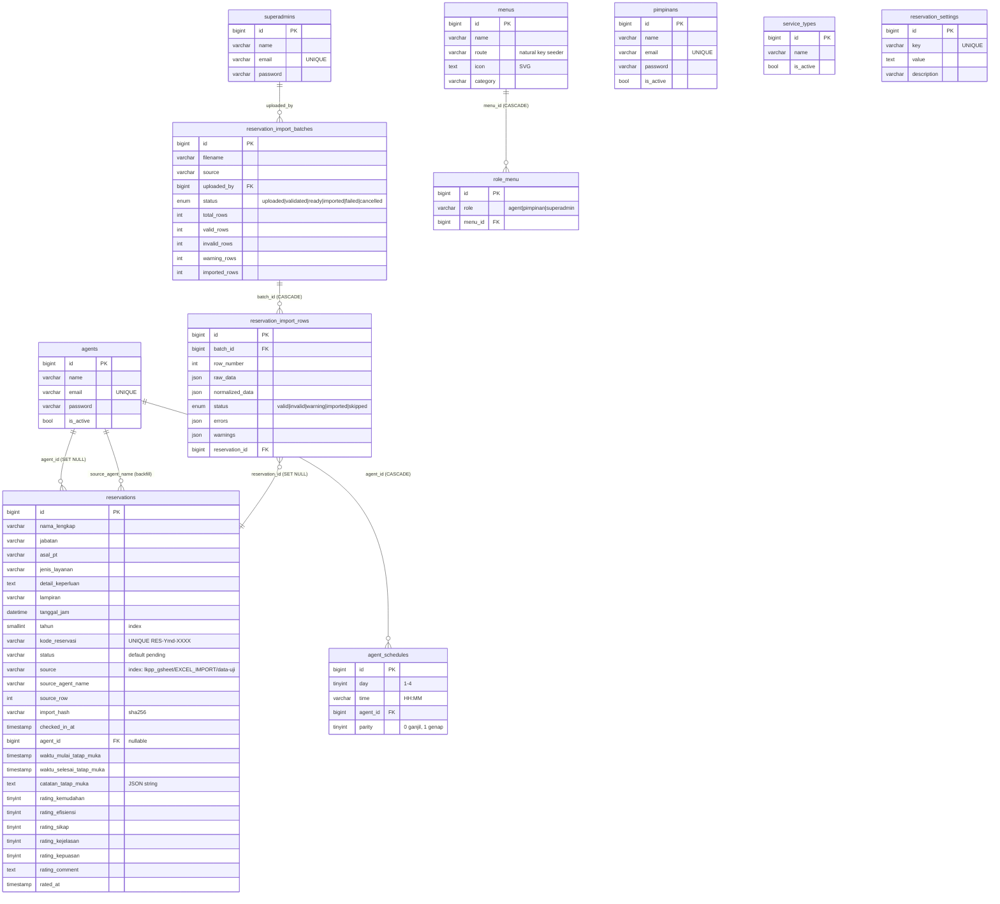
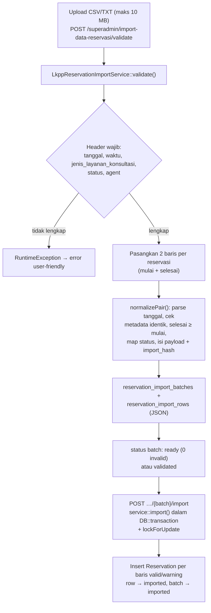

# Dokumentasi Sistem TemuLKPP

> Dokumen lengkap keseluruhan sistem **TemuLKPP** — aplikasi reservasi layanan tatap muka LKPP.
> Terakhir diperbarui: **3 November 2026**. Berkas ini bersifat *living document*; perbarui bila ada perubahan rute, skema, atau aturan bisnis.

**Daftar Isi**

1. [Ringkasan Sistem](#1-ringkasan-sistem)
2. [Arsitektur & Stack Teknologi](#2-arsitektur--stack-teknologi)
3. [Struktur Repositori](#3-struktur-repositori)
4. [Peran Pengguna & Hak Akses](#4-peran-pengguna--hak-akses)
5. [Autentikasi & Otorisasi](#5-autentikasi--otorisasi)
6. [Alur Bisnis Inti](#6-alur-bisnis-inti)
7. [Modul Fungsional per Peran](#7-modul-fungsional-per-peran)
8. [Detail Logika Controller](#8-detail-logika-controller)
9. [Skema Database](#9-skema-database)
10. [Aturan & Konstanta Bisnis](#10-aturan--konstanta-bisnis)
11. [Integrasi Apache Superset](#11-integrasi-apache-superset)
12. [Impor Data Historis LKPP](#12-impor-data-historis-lkpp)
13. [Konfigurasi Environment](#13-konfigurasi-environment)
14. [Deployment & Operasional](#14-deployment--operasional)
15. [Pengujian (Test Suite)](#15-pengujian-test-suite)
16. [Dokumen Diagram (docs/)](#16-dokumen-diagram-docs)
17. [Keamanan](#17-keamanan)
18. [Known Issues & Technical Debt](#18-known-issues--technical-debt)
19. [Troubleshooting](#19-troubleshooting)
20. [Lampiran](#20-lampiran)

---

## 1. Ringkasan Sistem

TemuLKPP adalah aplikasi manajemen **reservasi layanan tatap muka/konsultasi LKPP** yang menghubungkan lima aktor:

| Aktor | Kebutuhan utama |
|---|---|
| **Tamu (pengguna umum)** | Membuat reservasi, unduh tiket (PDF + QR), reschedule/batal dengan kode reservasi, beri penilaian |
| **Resepsionis / Front Desk** | Mencari & mengonfirmasi kedatangan tamu berdasarkan kode reservasi |
| **Agent** | Melihat jadwal & detail layanan, memulai/mengakhiri sesi tatap muka, mencatat hasil konsultasi |
| **Pimpinan** | Monitoring layanan, performa agent, laporan cetak, dashboard analitik |
| **Superadmin** | Master data, perizinan menu, aturan reservasi, impor data historis, laporan, dashboard analitik |

Sistem terdiri dari **dua stack terpisah dalam satu repo**:

- **`web/`** — Aplikasi Laravel (PHP 8.3, Blade + Vite + Tailwind/Flowbite, MySQL) untuk seluruh CRUD, alur reservasi, autentikasi, dan laporan.
- **`apache/`** — Apache Superset 6.1.0 di Docker untuk dashboard analitik yang **di-embed** ke halaman dashboard internal, dilindungi *guest token* + *Row-Level Security*.

### Tujuan Produk

- Mempermudah pengguna membuat reservasi layanan.
- Mengelola perubahan jadwal dan status kedatangan.
- Membantu Agent menangani jadwal dan proses pertemuan.
- Memberi Pimpinan/Superadmin metrik operasional, laporan, dan performa Agent.
- Menyediakan akses dashboard analitik berbasis peran.

---

## 2. Arsitektur & Stack Teknologi

### 2.1 Diagram arsitektur



### 2.2 Stack teknologi

| Lapisan | Teknologi |
|---|---|
| Backend | Laravel 13 (struktur `bootstrap/app.php` gaya Laravel 11/12), PHP 8.3 |
| Frontend | Blade templates, Vite ^8, Tailwind CSS ^4, Flowbite, SweetAlert2, html5-qrcode |
| Database | MySQL/MariaDB (host, port 3306) — session/cache/queue memakai driver `database` |
| PDF & QR | DomPDF + SimpleSoftwareIO QrCode |
| BI / Analytics | Apache Superset 6.1.0 (container), PyMySQL, embed SDK `@superset-ui/embeded-sdk@0.2.0` via CDN |
| Container | Docker Compose — `web/docker-compose.yml` (backend + frontend), `apache/docker-compose.yml` (superset) |
| Test | Pest (PHPUnit) di `web/tests/` |

---

## 3. Struktur Repositori

```text
temulkpp-website/
├── web/                          # Aplikasi Laravel
│   ├── app/
│   │   ├── Console/Commands/     # ImportLkppReservations (reservations:import-lkpp)
│   │   ├── Http/
│   │   │   ├── Controllers/      # Agents/, Auth/, FrontDesk/, Pimpinan/, Superadmin/, Users/, Concerns/
│   │   │   └── Middleware/       # EnsureMenuPermission (menu), EnsureAgentUser (agent)
│   │   ├── Models/               # 12 model Eloquent
│   │   ├── Providers/            # AppServiceProvider (view composer sidebar agent)
│   │   └── Services/             # LkppReservationImportService
│   ├── config/                   # auth.php, superset.php, dll.
│   ├── database/migrations/      # 30 file migrasi
│   ├── database/seeders/         # 10 seeder
│   ├── resources/views/          # Blade (layouts/, partials/, roles/<peran>/)
│   ├── routes/web.php            # SATU-satunya file route (tidak ada api.php)
│   ├── tests/                    # Pest: Feature/ (12 file), Unit/
│   ├── docker-compose.yml, backend/Dockerfile, frontend/Dockerfile, docker/apache-vhost.conf
│   └── DOCKER_APP.md
├── apache/                       # Stack Apache Superset
│   ├── Dockerfile, docker-compose.yml, superset_config.py
│   ├── sync_mysql_connection.py  # jalan saat boot
│   ├── add_pimpinan_charts.py    # jalan saat boot (idempoten)
│   ├── add_triwulan_filter.py    # jalan saat boot (idempoten)
│   ├── provision_superset.py, add_jenis_data_filter.py, remove_jenis_data_filter_34.py, fix_windows.py
│   ├── head_custom_extra.html    # override CSS Superset
│   ├── superset-data/superset.db # METADATA Superset (jangan dihapus/hapus volume)
│   └── DOCKER_SUPERSET.md
├── docs/                         # PRD + 22 diagram .puml + .png + SUPERSET_RATING_CHARTS.md
├── olah_data/, data/             # Sumber Excel/CSV
├── temulkpp.sql                  # Dump MySQL (schema + data historis)
├── data_siap_import.sql          # INSERT data siap import (butuh skema pasca-rating)
├── DOKUMENTASI_SISTEM.md         # Dokumen ini
├── PRD & panduan lain: docs/prd.md, SETUP_CLIENT.md, RUNNING_SCRIPT.md, MIGRATION_GUIDE.md
└── superset.db                   # Backup metadata Superset (root)
```

---

## 4. Peran Pengguna & Hak Akses

| Peran | Login | Contoh halaman | Hak utama |
|---|---|---|---|
| **Tamu** | Tidak perlu login | `/reservasi`, `/atur-ulang-jadwal`, `/penilaian` | Buat reservasi, unduh tiket, reschedule/batal (dengan kode), beri rating |
| **Front Desk** | Tidak perlu login | `/front-desk` | Cari & konfirmasi check-in berdasarkan kode reservasi |
| **Agent** | Guard `agent` | `/agent/dashboard`, `/agent/jadwal`, `/agent/detail-layanan`, `/agent/tatap-muka/{kode}` | Lihat jadwal sendiri, verifikasi tiket, mulai/akhiri sesi, catatan, dashboard Superset ber-RLS `agent_id` |
| **Pimpinan** | Guard `pimpinan` | `/pimpinan/*` | Dashboard, layanan berjalan/selesai, performa agent, laporan + cetak PDF, Superset |
| **Superadmin** | Guard `superadmin` | `/superadmin/*` | Semua fitur Pimpinan + master data, perizinan menu, pengaturan reservasi, impor data historis |

> **Catatan:** `/front-desk` dan `/agent/konfirmasi-tiket` berada **di luar** grup `auth:*` — siapa pun yang mengetahui URL dapat mengaksesnya (lihat [§17 Keamanan](#17-keamanan)).

---

## 5. Autentikasi & Otorisasi

### 5.1 Guard (config/auth.php)

Empat guard terpisah, semuanya driver `session` + provider eloquent:

| Guard | Model | Tabel | Catatan |
|---|---|---|---|
| `web` | `User` | `users` | Bawaan Laravel, **tidak dipakai** aplikasi utama |
| `agent` | `Agent` | `agents` | Ada `is_active` |
| `pimpinan` | `Pimpinan` | `pimpinans` | Ada `is_active` |
| `superadmin` | `Superadmin` | `superadmins` | **Tanpa** `is_active` (selalu aktif) |

**Login** (`Auth\LoginController@store`, route `POST /auth/login`, **tanpa** middleware `guest:`):

1. Attempt berurutan: **agent → pimpinan → superadmin**.
2. Agent & Pimpinan: bila `is_active = false` → logout guard itu saja + flash `error_inactive`.
3. Superadmin: tanpa cek status.
4. Sukses → `session()->regenerate()` + `redirect()->intended()`; gagal ketiganya → `ValidationException` "Email atau password tidak sesuai…".
5. **Multi-actor per browser**: satu browser boleh login beberapa aktor sekaligus — tiap guard menyimpan kunci `login_{guard}_…` yang terpisah di session yang sama, jadi tidak perlu logout aktor sebelumnya untuk login aktor lain. Halaman `GET /auth/login` selalu terbuka dan menampilkan daftar "Sedang login di browser ini" (link ke dashboard masing-masing + logout per aktor).
6. **Logout** (`POST /auth/logout`): membaca input `guard` (`agent|pimpinan|superadmin`) dari form sidebar, lalu `logout()` **hanya guard tersebut** + `regenerateToken()` — sesi aktor lain tetap utuh. Tanpa input `guard` (mis. tombol "Logout dari semua aktor") → logout semua guard + `session()->invalidate()`.

UI pendukung: sidebar/mobile-header memilih tampilan dari **layout halaman** (`$sidebarRole` / `$mobileRole`), bukan dari guard yang sedang login, agar aktor yang benar tampil walau banyak aktor login bersamaan.

Konfigurasi `bootstrap/app.php`: `redirectGuestsTo → route('login')`, `redirectUsersTo → route('agent.dashboard')`, health check `/up`.

### 5.2 Otorisasi menu — `EnsureMenuPermission` (alias `menu`)

Middleware `menu:agent|pimpinan|superadmin` pada hampir semua route internal:

1. Ambil `route()->getName()`.
2. Ambil semua `role_menu` + `menus` untuk role tersebut.
3. Diizinkan bila ada menu dengan `route` **exact match** ATAU **prefix namespace segmen pertama** (mis. menu `agent.dashboard` membuka semua `agent.*`; menu `superadmin.reservation-import.index` membuka `…import.show`).
4. Tidak lolos → `abort(403, 'Anda tidak memiliki akses ke halaman ini.')`.

Sumber kebenaran: tabel `menus` + `role_menu`, dikelola di halaman **`/superadmin/perizinan`** (update = delete-all lalu insert ulang dalam transaksi), di-seed oleh `MenuSeeder` (18 menu: agent 3, pimpinan 5, superadmin 10).

> Route **tanpa** `menu:*`: `agent.file.download`, `agent.tatap-muka*`, `superset.guest-token`, seluruh route publik & front desk.

### 5.3 Middleware `EnsureAgentUser` (alias `agent`)

Mengecek `$request->user('agent')` dan `is_active` per request (bila null/nonaktif → logout **guard agent saja** + redirect login; sesi aktor lain tidak ikut terhapus).
**Saat ini alias terdaftar tetapi tidak dipasang di route mana pun** — pengecekan `is_active` hanya terjadi saat login.

---

## 6. Alur Bisnis Inti

### 6.1 Lifecycle status reservasi

Status disimpan sebagai `varchar(50)` (**bukan ENUM di DB**); integritas dijaga aplikasi.



| Status | Label UI | Kelompok |
|---|---|---|
| `pending` | Menunggu | Berjalan |
| `checked_in_front_desk` | Sudah Check-In | Berjalan |
| `in_progress` | Sedang Berlangsung | Berjalan |
| `completed` | Selesai | Terminal |
| `expired_front_desk` | Kedaluwarsa | Terminal |
| `dialihkan_ke_l2` | Dialihkan ke L2 | Berjalan (data historis) |

`ONGOING_STATUSES` (dipakai Pimpinan & Superadmin) = `[pending, checked_in_front_desk, in_progress, dialihkan_ke_l2]`.

### 6.2 Aturan reservasi (tabel `reservation_settings` — key/value)

| Key | Default | Keterangan |
|---|---|---|
| `available_days` | `[1,2,3,4]` | Senin–Kamis (ISO day-of-week) |
| `max_reservations_per_slot` | `7` | Kapasitas maksimal per slot jam |
| `consultation_duration_minutes` | `40` | Durasi satu slot |
| `morning_start` / `morning_end` | `08:00` / `11:20` | Sesi pagi (6 slot) |
| `afternoon_start` / `afternoon_end` | `13:00` / `15:40` | Sesi siang (5 slot) |

Slot harian: `08:00, 08:40, 09:20, 10:00, 10:40, 11:20` (pagi) + `13:00, 13:40, 14:20, 15:00, 15:40` (siang) = **11 slot × 4 hari**.

Urutan validasi `ReservasiController@store`:
1. Waktu reservasi harus **masa depan** (detik di-nol-kan).
2. Hari harus dalam `available_days`.
3. Jam harus persis salah satu slot hasil hitungan (kelipatan durasi).
4. Slot belum penuh (`count < max_reservations_per_slot`).
5. Kode reservasi unik `RES-Ymd-XXXX` (4 karakter acak uppercase).
6. Lampiran (PDF/JPEG/PNG, maks 5 MB) → disk `public/lampirans/LAMPIRAN-{kode}.{ext}`.
7. Alokasi agent otomatis → redirect dengan kode reservasi.

### 6.3 Alokasi Agent otomatis

Dua titik: `ReservasiController::resolveAssignedAgentId` (saat buat reservasi) dan `ReservationCheckInController::resolveFallbackAgentId` (fallback saat check-in bila `agent_id` kosong).

**Tingkat pemilihan (deterministik, tanpa random):**

1. Kandidat **terjadwal** di `agent_schedules` (cocok `day = isoWeekDay`, `time = H:i`, `parity = isoWeek() % 2`) dan belum menempati slot yang sama.
2. Semua agent yang **bebas** di jam itu.
3. Seluruh agent (semua dihitung bebannya).

**Filter kandidat:** agent yang sudah kebagian pada slot yang sama dibuang (1 slot = maksimal 7 agent berbeda).

**Ranking beban (`pickFairAgentId`) — terkecil menang:**

1. `same_day_reservations_count` (reservasi hari yang sama)
2. `same_week_reservations_count` (rentang Sen–Minggu Carbon)
3. `active_reservations_count` (status `pending`/`checked_in_front_desk`/`in_progress`)
4. `total_reservations_count`
5. `id` terkecil

### 6.4 Jadwal agent (`agent_schedules`)

- Skema: `day (1-4)`, `time HH:MM`, `agent_id`, `parity (0 = minggu ganjil, 1 = minggu genap)`, unik `(day,time,parity,agent_id)`.
- `parity = (int) isoWeek() % 2`.
- Terisi **616 baris** oleh `AgentScheduleSeeder` (2 parity × 4 hari × 11 slot × 7 agent) — setiap `(parity,day,time)` tepat **7 agent**.
- Pola `patternPlan` saat ada tepat 16 agent aktif (rotasi libur ganjil/genap, tiap hari 7 pagi + 7 siang); fallback `greedyPlan` bila jumlah agent ≠ 16 (beban hari kerja terendah dulu, tanpa acak).
- Dua agent tidak berjadwal tiap hari (libur berputar tiap minggu); beban total ± 38–39 slot per dua minggu.

### 6.5 Front Desk (grace period 15 menit)

Konstanta `LATE_CONFIRMATION_GRACE_MINUTES = 15`.

- `GET /front-desk` → pencarian kode + `refreshReservationStatus()` + info hitung mundur (`is_late`, `remaining_seconds`, `grace_deadline_iso`).
- `refreshReservationStatus()`:
  - `pending` lewat `tanggal_jam + 15 menit` → `expired_front_desk`.
  - **Self-healing**: `expired_front_desk` yang masih hari sama dan belum lewat grace → kembali `pending`.
- `PATCH /front-desk/{kode}/confirm` menolak bila: sudah expired, **tanggal sekarang ≠ tanggal reservasi**, atau lewat grace. Berhasil → `checked_in_front_desk` + `checked_in_at = now()` + isi `agent_id` (fallback alokasi fair). Mendukung respons JSON untuk fetch/AJAX.

### 6.6 Sesi tatap muka (Agent)

Konstanta `DEFAULT_SESSION_DURATION_SECONDS = 2400` (40 menit).

- Semua route difilter `agent_id = Auth::guard('agent')->id()` — agent tidak dapat membuka reservasi agent lain.
- `start()`: hanya dari `checked_in_front_desk` → `in_progress` + `waktu_mulai_tatap_muka`.
- `show()`: bila `waktu_mulai_tatap_muka` masih null → diisi otomatis (**side effect pada GET**). Durasi sesi dikurangi bila check-in terlambat agar tetap berakhir pada slot akhir.
- `end()`: validasi `catatan` min 5 karakter, file opsional (maks 5 MB → `public/catatan/CATATAN-{kode}.{ext}`) → `completed` + `waktu_selesai_tatap_muka` + `catatan_tatap_muka` (JSON string `{"teks":…, "file":…}`).

### 6.7 Penilaian tamu (publik)

Route `/penilaian` (`PenilaianController`), tanpa login, berbasis kode reservasi.

5 pertanyaan Likert 1–5 (`Reservation::RATING_QUESTIONS`): **Kemudahan Verifikasi, Efisiensi Waktu, Sikap Pelayanan, Kejelasan & Solusi, Kepuasan Keseluruhan** + komentar (opsional, maks 1000 karakter).

Blokir penilaian (`resolveRatingState`) bila:
1. Sudah memiliki rating lengkap (pernah dinilai).
2. Status ≠ `completed`.
3. Waktu selesai tidak tercatat.
4. **Selesai pada hari kalender berbeda dengan hari ini** (jendela penilaian 1 hari).

Simpan: 5 kolom + `rating_comment` + `rated_at = now()`. Data historis tanpa rating → `average_rating = null` agar rata-rata tidak tercemar.

### 6.8 Reschedule & pembatalan (publik)

- `GET /atur-ulang-jadwal?kode_reservasi=…` — cari reservasi; slot asal tidak dihitung penuh.
- `PUT` — validasi sama dengan pembuatan (masa depan, hari diizinkan, slot tujuan belum penuh). **Reschedule = membuat reservasi BARU (kode baru) lalu menghapus yang lama** dalam `DB::transaction`; `agent_id` tidak ikut terbawa (dialokasi ulang saat check-in).
- `DELETE` — hard delete (pembatalan).

---

## 7. Modul Fungsional per Peran

### 7.1 Tamu / Publik

| URL | Method | Route name | Fungsi |
|---|---|---|---|
| `/` | GET | — | redirect → `/reservasi` |
| `/reservasi` | GET/POST | `reservasi`, `reservasi.store` | Form & pembuatan reservasi |
| `/reservasi/{kode}/download` | GET | `reservasi.download` | Tiket PDF + QR |
| `/atur-ulang-jadwal` | GET/PUT/DELETE | `atur-ulang-jadwal*` | Reschedule / pembatalan |
| `/penilaian` | GET | `penilaian` | Input kode |
| `/penilaian/{kode}` | GET/POST | `penilaian.show`, `penilaian.store` | Form & simpan rating |
| `/front-desk` | GET/PATCH | `front-desk*` | Konfirmasi kedatangan |
| `/agent/konfirmasi-tiket` | GET | `agent.konfirmasi-tiket` | Verifikasi tiket (read-only) |
| `/auth/login`, `/auth/logout` | GET/POST | `login*`, `logout` | Login multi-guard |

### 7.2 Agent (`auth:agent`, prefix `/agent`)

| URL | Route name | Fungsi |
|---|---|---|
| `/agent/dashboard` | `agent.dashboard` | Ringkasan tugas hari ini + section penilaian miliknya |
| `/agent/jadwal` | `agent.jadwal` | Jadwal hari ini & mendatang + filter (q, status, tanggal) |
| `/agent/detail-layanan` | `agent.detail-layanan` | Daftar layanan (decode catatan, durasi, lampiran) |
| `/agent/file/{reservation}/{type}` | `agent.file.download` | Unduh lampiran `tamu`/`catatan` (guard kepemilikan) |
| `/agent/tatap-muka/{kode}` | `agent.tatap-muka` | Halaman sesi (show) |
| `/agent/tatap-muka/{kode}/start` | `agent.tatap-muka.start` | Mulai sesi |
| `/agent/tatap-muka/{kode}/end` | `agent.tatap-muka.end` | Akhiri sesi + catatan |

### 7.3 Pimpinan (`auth:pimpinan` + `menu:pimpinan`, prefix `/pimpinan`)

| URL | Route name | Fungsi |
|---|---|---|
| `/pimpinan/dashboard` | `pimpinan.dashboard` | Embed Superset + metrik & penilaian |
| `/pimpinan/layanan-selesai` | `pimpinan.layanan-selesai` | Filter q/agent/tanggal (`waktu_selesai_tatap_muka`), paginasi 15 |
| `/pimpinan/layanan-berjalan` | `pimpinan.layanan-berjalan` | Filter + status, kartu hitung status |
| `/pimpinan/performa-agent` | `pimpinan.performa-agent` | withCount total/selesai/ongoing/rated + `average_rating` |
| `/pimpinan/laporan` | `pimpinan.laporan` | Filter laporan + ringkasan |
| `/pimpinan/laporan/cetak` | `pimpinan.laporan.cetak` | PDF (DomPDF, maks 100 baris, stream) |

### 7.4 Superadmin (`auth:superadmin` + `menu:superadmin`, prefix `/superadmin`)

| Kelompok | Route name | Fungsi |
|---|---|---|
| Dashboard | `superadmin.dashboard` | Metrik + mode data (`?data=uji`) |
| Perizinan | `superadmin.permissions[.update]` | Kelola `menus` × `role_menu` per role |
| Master agent | `superadmin.master-agent[...]` | CRUD + toggle `is_active`, filter q/status, paginasi 5 |
| Master pimpinan | `superadmin.master-pimpinan[...]` | Sama seperti master agent |
| Laporan | `superadmin.layanan-*`, `performa-agent`, `laporan[.cetak]` | Metodologi sama dengan Pimpinan |
| Pengaturan | `superadmin.reservation-settings[.update/.reset]` | 8 key aturan reservasi + validasi silang jadwal |
| Service types | `superadmin.service-types.store/.toggle/.destroy` | CRUD jenis layanan aktif |
| Impor | `superadmin.reservation-import.index/.validate/.show/.import` | 2 tahap: staging → import |

---

## 8. Detail Logika Controller

| Controller (file) | Metode utama | Catatan logika penting |
|---|---|---|
| `Users/ReservasiController` | `index`, `store`, `download`, `resolveAssignedAgentId`, `pickFairAgentId` | Validasi slot bertingkat; `Schema::hasTable` aman bila tabel kosong; PDF A4 DomPDF berisi QR SVG berisi kode |
| `Users/AturUlangJadwalController` | `index`, `update`, `destroy` | Reschedule = insert baru + hard delete lama (kode & `agent_id` berubah) |
| `Users/PenilaianController` | `index`, `show`, `store`, `resolveRatingState`, `resolveFinishedAt` | `resolveFinishedAt`: fallback `waktu_selesai_tatap_muka` → `tanggal_jam` (data historis) |
| `FrontDesk/ReservationCheckInController` | `index`, `confirm`, `refreshReservationStatus`, `resolveFallbackAgentId` | Grace 15 menit, hari sama, self-healing, respons JSON |
| `Agents/MeetingController` | `show`, `start`, `end`, `resolveAgentReservation` | Scope agent login; durasi 2400 dtk dipotong bila telat; `show()` punya side effect |
| `Agents/DashboardController` | `index` | `taskSummary` + spread `ratingDashboardData($agentId)` |
| `Agents/ScheduleController` | `index` | 2 koleksi: `todayReservations` & `upcomingReservations` (paginasi 20) |
| `Agents/ServiceDetailController` | `index`, `downloadFile` | Decode `catatan_tatap_muka` JSON; `abort_unless` pemilik reservasi |
| `Agents/TicketVerificationController` | `index` | Read-only, tanpa perubahan status |
| `Auth/LoginController` | `create`, `store`, `destroy` | Multi-guard attempt berurutan |
| `SuperadminController` | `dashboard`, `master*`, `permissions`, `*Services`, `agentPerformance`, `report`, `printReport` | `MAX_EXPORT_ROWS = 100`; perizinan = delete-all + insert dalam transaksi |
| `Pimpinan/DashboardController` | identik pola Superadmin tanpa master/perizinan | Beda kecil: `q` max 100, `only_active` = punya reservasi ongoing, `statusCounts` dihitung setelah filter status |
| `Superadmin/ReservationSettingController` | `index`, `updateSettings`, `resetSettings`, `storeServiceType`, `toggleServiceType`, `destroyServiceType` | Validasi silang: pagi/siang tidak boleh tumpang tindih, durasi ≤ panjang sesi |
| `Superadmin/ReservationImportController` | `index`, `validateFile`, `show`, `import` | DI `LkppReservationImportService`; error di-log + flash |
| `SupersetController` | `getGuestToken` | Login admin → RLS → guest token (lihat §11) |
| `Concerns/BuildsRatingDashboard` | `ratedReservations`, `ratingAveragesFor`, `ratingAnswerCountsFor`, `ratingDashboardData` | `AVG` via `toBase()` (hindari cast integer); distribusi skor via `SUM(CASE…)` |

**Kode tak terpakai (dead code):** `Users/KontakController`, `Users/TentangKamiController` (view tidak ada, tidak di-route), `Agents/Auth/LoginController` (login resmi memakai `Auth\LoginController`), `ReservationSettingController::updateServiceType` (tanpa route).

**Command artisan:** `php artisan reservations:import-lkpp {file} [--dry-run]` — memakai service import yang sama. Tidak ada scheduler/queue periodik (`routes/console.php` hanya `inspire`).

---

## 9. Skema Database

### 9.1 Diagram relasi (ER)



### 9.2 Tabel utama (ringkas)

| Tabel | Sumber | Isi / fungsi |
|---|---|---|
| `reservations` | 7 migrasi bertahap | Inti sistem; UNIQUE `kode_reservasi`, FK `agent_id` SET NULL, index `source` & `tahun`; **tidak ada index `status`** |
| `agents`, `pimpinans`, `superadmins` | `create_*_table` + `add_is_active` | Akun per guard; `superadmins` tanpa `is_active` |
| `menus`, `role_menu` | `2026_04_30_*` | Izin halaman per role (tanpa unique `(role,menu_id)`) |
| `service_types` | `2026_05_03_163917` | Jenis layanan (4 default + tambahan) |
| `reservation_settings` | `2026_05_03_163921` | Key/value aturan reservasi (UNIQUE `key`) |
| `agent_schedules` | `2026_10_17_000001` | Jadwal per parity; UNIK `(day,time,parity,agent_id)` + index `(day,time,parity)` |
| `reservation_import_batches/rows` | `2026_09_26_000004` | Staging impor CSV (JSON payload) |
| `users`, `sessions`, `cache*`, `jobs*`, `failed_jobs` | migrasi bawaan Laravel | Session/cache/queue driver `database` |

### 9.3 Migrasi data (bukan DDL)

| Migrasi | Fungsi |
|---|---|
| `2026_09_26_000002/3` | Normalisasi kode `LKPP-*` → `RES-Ymd-XXXX` |
| `2026_09_26_000005` | Pasangkan baris mulai/selesai GSheet (2 baris → 1 reservasi) + `import_hash` gabungan |
| `2026_10_27_000001` | Mapping status Indonesia → kanonik (`Selesai` → `completed`, dst.) |
| `2026_10_28_000001` | Backfill `agent_id` JOIN `agents` ON `source_agent_name`; `'Agent Cadangan'` → Agent 6; baris `data-uji` tidak disentuh |

### 9.4 Seeder

| Seeder | Isi | Idempoten? |
|---|---|---|
| `DatabaseSeeder` | Memanggil: AgentUser → Pimpinan → Superadmin → Menu → ReservationSetting → AgentSchedule | — |
| `AgentUserSeeder` | 16 agent `Agent 1..16`, `agent.{n}@temulkpp.com`, `Agent@12345` | ✅ `updateOrCreate` |
| `PimpinanSeeder` | 3 pimpinan, `Pimpinan@12345` | ✅ |
| `SuperadminSeeder` | 1 superadmin `superadmin@temulkpp.com` / `password` | ❌ `create` (gagal bila dobel) |
| `MenuSeeder` | 18 menu + 18 baris `role_menu` | ✅ |
| `ReservationSettingSeeder` | 4 `service_types` + 7 `reservation_settings` | ✅ `firstOrCreate` |
| `AgentScheduleSeeder` | 616 baris jadwal (DELETE lalu INSERT) | ⚠️ replace-all |
| `ReservationCodeSeeder` | Isi `kode_reservasi` kosong (format 6 karakter — beda dengan aplikasi) | manual |
| `DashboardSeeder` | 30 reservasi contoh (`RSV-XXXXXX`) | manual |
| `PenilaianSampleSeeder` | 8 reservasi `completed` ber-rating (`source='system_test'`) | ✅ `updateOrCreate` |

### 9.5 File dump SQL

| File | Isi |
|---|---|
| `temulkpp.sql` (0,6 MB) | Dump penuh MariaDB 10.4 (5 Okt 2026): 19 tabel, **1.579 reservasi** (100% `source='lkpp_gsheet'`; `completed` 1.397, `dialihkan_ke_l2` 182; tahun 2024/2025/2026). **Belum punya** tabel `agent_schedules` & kolom rating |
| `data_siap_import.sql` (2,5 MB) | 2.755 `INSERT INTO reservations` (`source='EXCEL_IMPORT'`) + 2 `UPDATE` backfill `agent_id`; **butuh skema pasca-migrasi rating**; 7 baris `status='nan'` (sampah), seluruh `agent_id` NULL sebelum UPDATE dijalankan |

---

## 10. Aturan & Konstanta Bisnis

| Konstanta | Nilai | Lokasi |
|---|---|---|
| Grace period check-in | 15 menit | `ReservationCheckInController::LATE_CONFIRMATION_GRACE_MINUTES` |
| Durasi sesi tatap muka | 2400 detik (40 menit) | `MeetingController::DEFAULT_SESSION_DURATION_SECONDS` |
| Hari tersedia | Sen–Kam (`[1,2,3,4]`) | `reservation_settings.available_days` |
| Kapasitas slot | 7 reservasi | `reservation_settings.max_reservations_per_slot` |
| Durasi slot | 40 menit | `reservation_settings.consultation_duration_minutes` |
| Jendela penilaian | Hari kalender yang sama dengan waktu selesai | `PenilaianController::resolveRatingState` |
| Skala rating | 1–5, 5 aspek + komentar ≤1000 | `Reservation::RATING_QUESTIONS` |
| Batas baris cetak PDF | 100 baris | `MAX_EXPORT_ROWS` (Pimpinan & Superadmin) |
| Batas lampiran | 5 MB (5120 KB) | Reservasi & catatan agent |
| Kolom data uji/historis | `source='data-uji'` ATAU `tanggal_jam >= 2026-10-01` | Global scope `Reservation::only_test_data` + kolom `jenis_data` Superset |
| Kode reservasi | `RES-YYYYMMDD-XXXX` (4 karakter unik) | `ReservasiController::store` |

---

## 11. Integrasi Apache Superset

### 11.1 Konsep

- Satu **dashboard template per role** (UUID di `web/.env`), **isolasi baris Agent** via klausa RLS pada guest token — bukan dashboard per agent.
- Laravel bertindak sebagai **trusted server**: login ke Superset API memakai akun admin, lalu meminta `guest_token` yang dibatasi `rls`.
- Embed dilakukan di browser via `supersetEmbeddedSdk.embedDashboard(...)` (SDK dari CDN unpkg, bukan dependency npm).

### 11.2 Endpoint guest token

`GET /superset/guest-token?dashboardId=…&data=uji|historis` (middleware `auth:agent,pimpinan,superadmin`):

1. `dashboardId` wajib; role dideteksi dari guard aktif (agent → pimpinan → superadmin).
2. **Autorisasi**: `dashboardId` harus persis `config("superset.dashboards.{role}")`, selain itu **403**.
3. Login `POST {internal_url}/api/v1/security/login` (provider `db`) → `access_token`.
4. Susun RLS:
   - Klausul **Jenis Data** (dataset reservasi 1, 4, 5 saja): `data=uji` → `tanggal_jam >= '2026-10-01'`; selain itu `(tanggal_jam < '2026-10-01' OR tanggal_jam IS NULL)`.
   - Role **agent** → tambahan klausa global `agent_id = <id>` (di-cast `int` cegah injeksi klausa).
   - Dataset 2 (`agents`) & 3 (`virtual_roles`) sengaja **tidak** di-scope (tidak punya kolom `tanggal_jam`).
5. `POST …/api/v1/security/guest_token/` → `{"token": …}`. Error dicatat ke `web/storage/logs`.

### 11.3 View yang meng-embed

`resources/views/roles/{agents,pimpinan,superadmin}/dashboard/index.blade.php`:
- `fetch(route('superset.guest-token') + '?dashboardId=' + config('superset.dashboards.<role>') + '&data=…')`
- → `supersetEmbeddedSdk.embedDashboard({ id, supersetDomain: config('superset.public_url'), mountPoint, fetchGuestToken, dashboardUiConfig:{hideTitle, hideControls…} })`.

### 11.4 Konfigurasi kunci `apache/superset_config.py`

| Kunci | Nilai | Catatan |
|---|---|---|
| `SQLALCHEMY_DATABASE_URI` | `sqlite:///{SUPERSET_HOME}/superset.db` | Metadata di bind-mount `superset-data/` |
| `SECRET_KEY` | env `SUPERSET_SECRET_KEY` | **Wajib sama** dengan saat `superset.db` dibuat |
| `GUEST_TOKEN_JWT_SECRET` / `ALGO` / `EXP` | env / HS256 / 3600 dtk | |
| `FEATURE_FLAGS` | `EMBEDDED_SUPERSET=True`, native filters, `DASHBOARD_RBAC`, `EMBEDDABLE_CHARTS` | |
| `GUEST_ROLE_NAME` | `"Admin"` | Guest token memakai role Admin |
| `PUBLIC_ROLE_LIKE` | `"Admin"` | Role publik meniru Admin |
| `AUTH_ROLE_PUBLIC` | didefinisikan 2× → efektif `'Public'` | Inkonsistensi |
| `PREVENT_UNSAFE_DB_CONNECTIONS` | `False` | Izinkan `host.docker.internal` |
| `WTF_CSRF_ENABLED` | `False` (+ `WTF_CSRF_METHODS=[]`) | CSRF mati total |
| CORS / Talisman | `CORS_ORIGINS` env (default `http://localhost:8000`), `frame-ancestors` = origin tersebut | |
| Custom `SECURITY_MANAGER` | `raise_for_access` menelan error "Guest user cannot modify chart payload" | |

### 11.5 Boot container (`apache/docker-compose.yml`)

```text
superset db upgrade
  → python sync_mysql_connection.py      # sinkron URI MySQL ke MYSQL_URI
  → superset init                        # role/permission (termasuk Admin)
  → python add_pimpinan_charts.py        # idempoten: dataset SQL Lab, chart, dashboard, repair layout
  → python add_triwulan_filter.py         # idempoten: kolom triwulan (ds 1/4/5) + native filter Triwulan
  → gunicorn superset.app:create_app() --bind 0.0.0.0:8088 --workers 1 --threads 4
```

Script penting:

| Script | Peran | Kapan jalan |
|---|---|---|
| `sync_mysql_connection.py` | Update `sqlalchemy_uri` semua Database ber-“mysql” → `MYSQL_URI` | Otomatis saat boot |
| `add_pimpinan_charts.py` | Bootstrap dataset `reservation_agent_analytics`, chart "Tren Permasalahan per Tahun" & "Kinerja Semua Agent", dashboard overview, **prune node CHART yatim**, set owner admin. Tidak pernah menimpa edit UI | Otomatis saat boot |
| `provision_superset.py` | Verifikasi via REST API: database, `allowed_domains`, guest token + RLS per agent, tulis `.provisioned.json` | Manual |
| `add_jenis_data_filter.py` | Tambah kolom `jenis_data` (dataset 1/4/5) + native filter `NATIVE_FILTER-TEMU_JENIS_DATA` (dashboard 2,3,4,5) | Manual |
| `add_triwulan_filter.py` | Tambah kolom `triwulan` (`QUARTER(tanggal_jam)` → `Triwulan I`–`IV`) di dataset 1/4/5 + native filter `NATIVE_FILTER-TEMU_TRIWULAN` (dashboard 2,3,4,5). Struktur & `controlValues` sama persis dengan filter `Tahun`; saling mengunci (Tahun 2024 + Triwulan I = Jan–Mar 2024) | Otomatis saat boot |
| `remove_jenis_data_filter_34.py` | Hapus native filter tersebut dari dashboard 3 & 4 | Manual |
| `fix_windows.py` | Reset URI MySQL, `allow_domain_list='*'`, `superset init` | Manual / fallback |
| `head_custom_extra.html` | CSS: tombol filter menempel, angka KPI tebal | Di-mount saat boot |

### 11.6 Dashboard & chart

| Role | `SUPERSET_*_DASHBOARD_ID` (contoh `.env.docker`) | UUID |
|---|---|---|
| Agent | `SUPERSET_AGENT_DASHBOARD_ID` | `dbd88673-b705-40cc-8fa0-b8b8a26e9afd` |
| Pimpinan | `SUPERSET_PIMPINAN_DASHBOARD_ID` | `1a2b3c4d-5e6f-7a8b-9c0d-1e2f3a4b5c6d` |
| Superadmin | `SUPERSET_SUPERADMIN_DASHBOARD_ID` | `da1f9b3b-8911-4eb7-a7eb-9df03b41bb1c` |

Legacy: `SUPERSET_DASHBOARD_ID` / `SUPERSET_EMBED_ID` sebagai fallback. Metadata harapan saat setup klien: **dashboards=3, charts=29, datasets=4, connections=1** (lihat `SETUP_CLIENT.md`).

Chart penilaian (lihat `docs/SUPERSET_RATING_CHARTS.md`): dataset virtual `rating_rata_rata` (id 5) & `rating_skor` (id 6), chart 36 "Distribusi Rata-rata Penilaian" & 37 "Sebaran Skala Penilaian (1–5)" di dashboard Superadmin.

---

## 12. Impor Data Historis LKPP

### 12.1 Alur 2 tahap (staging → commit)



### 12.2 Aturan normalisasi

- Format tanggal `n/j/y H:i` (mulai & selesai).
- Baris kosong `agent` → warning; agent tak dikenal → error; jenis layanan kosong → error.
- Status: `selesai|done` → `completed`; `dialihkan ke l2` → `dialihkan_ke_l2`; lainnya error.
- Data tamu dipalsukan: `nama_lengkap='Data LKPP'`, `jabatan='Data Import'`, `asal_pt='LKPP'`.
- `source='lkpp_gsheet'`, `source_agent_name`, `import_hash = sha256([awal, akhir, layanan, status, agent])`, kode `RES-Ymd-XXXX` unik.
- Enum batch: `uploaded → validated|ready → imported` (+ `failed`, `cancelled`).
- Enum baris: `valid | invalid | warning | imported | skipped`.

### 12.3 Idempotensi

Batch hanya bisa diimport sekali (status + `lockForUpdate`). **`import_hash` disimpan tetapi belum dipakai untuk dedup lintas batch** — jangan upload dua kali isi file yang sama.

---

## 13. Konfigurasi Environment

### 13.1 `web/.env.docker` (kunci utama)

```dotenv
APP_URL=http://localhost:8000
APP_KEY=base64:...                       # generate: docker compose run --rm backend php artisan key:generate --show
APP_DEBUG=true                            # false di production

DB_CONNECTION=mysql
DB_HOST=host.docker.internal              # MySQL berjalan di host Windows
DB_PORT=3306
DB_DATABASE=temulkpp
DB_USERNAME=root
DB_PASSWORD=

SESSION_DRIVER=database
CACHE_STORE=database
QUEUE_CONNECTION=database

SUPERSET_URL=http://host.docker.internal:8088
SUPERSET_INTERNAL_URL=http://host.docker.internal:8088   # server-to-server (minta guest token)
SUPERSET_PUBLIC_URL=http://localhost:8088                # untuk iframe di browser
SUPERSET_ADMIN_USERNAME=admin
SUPERSET_ADMIN_PASSWORD=...
SUPERSET_AGENT_DASHBOARD_ID=dbd88673-b705-40cc-8fa0-b8b8a26e9afd
SUPERSET_PIMPINAN_DASHBOARD_ID=1a2b3c4d-5e6f-7a8b-9c0d-1e2f3a4b5c6d
SUPERSET_SUPERADMIN_DASHBOARD_ID=da1f9b3b-8911-4eb7-a7eb-9df03b41bb1c
```

### 13.2 `apache/.env.docker`

```dotenv
SUPERSET_SECRET_KEY=...            # JANGAN diubah bila superset.db lama dipakai
GUEST_TOKEN_JWT_SECRET=...
SUPERSET_ADMIN_USERNAME=admin
SUPERSET_ADMIN_PASSWORD=...
MYSQL_URI=mysql+pymysql://root:@host.docker.internal:3306/temulkpp
LARAVEL_URL=http://host.docker.internal:8000
SUPERSET_URL=http://localhost:8088
CORS_ORIGINS=http://localhost:8000
```

---

## 14. Deployment & Operasional

### 14.1 Prasyarat

- Docker Desktop (port 3306, 8000, 8088, 5173 bebas).
- MySQL host dengan database `temulkpp` (restore `temulkpp.sql`).
- File wajib distribusi: `apache/superset-data/superset.db`, `temulkpp.sql`, `apache/.env.docker`, `web/.env.docker`, kedua `docker-compose.yml` (lihat `MIGRATION_GUIDE.md`).

### 14.2 Perintah harian

```powershell
# 1. Superset (SELALU dulu)
cd apache
docker compose up -d --build

# 2. Laravel (backend + frontend Vite)
cd ..\web
docker compose up -d --build

# Status & log
docker compose ps
docker compose logs -f backend
docker compose logs -f superset

# Stop TANPA menghapus data (JANGAN pakai down -v)
docker compose stop
```

### 14.3 URL akses

| Layanan | URL |
|---|---|
| Reservasi publik | `http://localhost:8000/reservasi` |
| Atur ulang jadwal | `http://localhost:8000/atur-ulang-jadwal` |
| Penilaian | `http://localhost:8000/penilaian` |
| Front desk | `http://localhost:8000/front-desk` |
| Login internal | `http://localhost:8000/auth/login` |
| Verifikasi tiket | `http://localhost:8000/agent/konfirmasi-tiket` |
| Dashboard Agent/Pimpinan/Superadmin | `http://localhost:8000/{agent\|pimpinan\|superadmin}/dashboard` |
| Superset | `http://localhost:8088` |
| Health check | `http://localhost:8000/up`, Superset `/health` |

### 14.4 Mode non-Docker (development)

Tiga terminal: `php artisan serve` (Laravel :8000), `npm run dev` (Vite :5173), Superset via venv (`superset run -p 8088`). Atau `composer run dev` untuk Laravel+queue+log viewer+Vite (tanpa Superset). Detail di `docs/prd.md` §8.

### 14.5 Larangan operasional

- ❌ `docker compose down -v` (menghapus volume metadata Superset).
- ❌ Menghapus/mengganti `apache/superset-data/superset.db` atau mengganti `SUPERSET_SECRET_KEY` sembarangan.
- ❌ Commit `web/.env.docker` berisi secret (kirim `.env.docker.example` saja).
- ❌ `php artisan migrate:reset` pada database berisi data produksi.

---

## 15. Pengujian (Test Suite)

Framework **Pest**. Jalankan: `cd web && php artisan test`.

| File test | Cakupan |
|---|---|
| `AgentAuthTest` (7) | Render login, login agent, proteksi route per role, redirect saat sudah login |
| `SupersetGuestTokenTest` (4) | RLS `agent_id` unik per agent, pimpinan tanpa restriksi, 403 lintas role |
| `ReservasiScheduleValidationTest` (5) | Tolak hari di luar Sen–Kam, jam di luar slot, slot penuh (7), waktu lampau; terima slot berikutnya |
| `ReservasiPdfTest` (1) | Unduhan tiket PDF |
| `AturUlangJadwalTest` (6) | Cari kode, tolak slot penuh, reschedule + kode baru, batal, validasi waktu |
| `FrontDeskCheckInTest` (6) | Check-in per kode, toleransi 15 menit, penolakan hari beda/terlalu telat, status expired |
| `PenilaianTest` (15) | Form publik, blokir belum selesai/selesai hari lain/ganda, simpan 5 rating, validasi rentang |
| `ImportLkppReservationsTest` (2) | Pemetaan status & agent, mode dry-run tanpa tulis |
| `ReservationImportWebTest` (2) | Upload + preview batch, agent tak dikenal memblokir |
| `SuperadminMasterDataTest` (2) | Pagination master data + filter `q` bertahan |
| `PimpinanPagesTest` (4) | Semua halaman pimpinan 200, validasi filter, PDF `application/pdf` |
| `ExampleTest` (2) | Root redirect, halaman reservasi OK |

> `phpstan.neon` tidak tersedia — PHPStan belum bisa dijalankan tanpa menambah konfigurasi/dependency.

---

## 16. Dokumen Diagram (docs/)

22 file `.puml` + pasangan `.png` di `docs/`:

**Diagram utama**
- `diagram-usecase.puml` — 5 aktor (Tamu, Resepsionis, Agent, Pimpinan, Superadmin) + use case utama.
- `class-diagram.puml` — model DB + relasi FK vs relasi logis + controller/service/middleware.
- `diagram-activity.puml` — alur end-to-end dengan swimlane per aktor.

**Diagram sekuens (19)**
`tamu-reservasi`, `atur-ulang-jadwal`, `checkin-resepsionis`, `login-agent`, `login-superadmin`, `jadwal-agent`, `tatap-muka-agent`, `penilaian`, `dashboard-pimpinan`, `dashboard-superadmin`, `monitoring-layanan-pimpinan`, `performa-agent-pimpinan`, `laporan-pimpinan`, `laporan-superadmin`, `pengaturan-reservasi`, `master-agent`, `master-pimpinan`, `perizinan-menu`, `impor-reservasi`.

Dokumen lain: `docs/prd.md` (PRD + panduan setup non-Docker), `docs/SUPERSET_RATING_CHARTS.md`, `SETUP_CLIENT.md`, `RUNNING_SCRIPT.md`, `MIGRATION_GUIDE.md`, `web/DOCKER_APP.md`, `apache/DOCKER_SUPERSET.md`.

---

## 17. Keamanan

| Aspek | Status saat ini | Rekomendasi |
|---|---|---|
| Auth internal | Session-based, 3 guard terpisah | ✅ |
| Otorisasi menu | Middleware `menu:*` + tabel izin | ✅, audit rutin di `/superadmin/perizinan` |
| Route publik | `/front-desk` & `/agent/konfirmasi-tiket` **tanpa auth** | Pertimbangkan PIN/kode akses front desk |
| Guest token Superset | `GUEST_ROLE_NAME=Admin` + `PUBLIC_ROLE_LIKE=Admin` | Turunkan ke role read-only khusus embed |
| CSRF Superset | `WTF_CSRF_ENABLED=False` | Evaluasi untuk production |
| CORS/CSP | Origin localhost | Sesuaikan domain deployment |
| `PREVENT_UNSAFE_DB_CONNECTIONS` | `False` | Hanya untuk dev lokal |
| Password seed | `password`, `Agent@12345`, dst. | Ganti seluruhnya di production |
| `APP_DEBUG` | `true` di `.env.docker` riil | `false` di production |
| Data sensitif | `temulkpp.sql`, `superset.db` berisi data operasional | Batasi akses & backup |
| Rate limiting | Tidak ada pada login/reservasi | Tambahkan throttle |
| Soft deletes | Tidak ada di `Reservation` | Reschedule/pembatalan = hard delete |

---

## 18. Known Issues & Technical Debt

1. **Race condition kapasitas slot** — cek `max_reservations_per_slot` di `ReservasiController@store` & atur-ulang jadwal **tanpa lock**; dua request bersamaan bisa melebihi 7 per slot. (Belum ada `lockForUpdate`.)
2. **`MeetingController@show` punya side effect** (GET mengubah status/waktu) — melanggar semantik GET, berbahaya bila diprefetch/crawler.
3. **Reschedule kehilangan `agent_id`** — `AturUlangJadwalController::update` membuat row baru + hard delete lama; kode berubah dan agent harus dialokasi ulang saat check-in.
4. **Perbedaan zona waktu data historis** — `tanggal_jam` vs `waktu_mulai_tatap_muka` bisa berbeda 7 jam (WIB vs UTC); hati-hati filter tanggal pada data lama.
5. **Tidak ada index `reservations.status`** — filter status melakukan full scan; pertimbangkan bila volume tumbuh.
6. **`EnsureAgentUser` tidak terpasang** — pengecekan `is_active` agent hanya saat login, bukan tiap request.
7. **Dead code**: `KontakController`, `TentangKamiController`, `Agents\Auth\LoginController`, `ReservationSettingController::updateServiceType`.
8. **Format kode reservasi tidak konsisten**: aplikasi/import `RES-Ymd-XXXX` (4), `ReservationCodeSeeder` 6 karakter, `DashboardSeeder` `RSV-XXXXXX`.
9. **`SuperadminSeeder` tidak idempoten** (`create`), seeder lain idempoten.
10. **Relasi `role_menu` tanpa unique `(role, menu_id)`** dan `menus.route` tanpa unique DB — idempotensi bergantung pada seeder/aplikasi.
11. **`import_hash` belum dipakai dedup** lintas batch; baris `skipped` enum tidak pernah ditulis.
12. **Data `status='nan'`** (7 baris di `data_siap_import.sql`) dibiarkan; tidak masuk hitungan status mana pun.
13. **Pemetaan `source_agent_name` → `agent_id` off-by-one** pada data historis (id 8 = "Abdi Negara" nonaktif, sehingga `Agent 8` → id 9 … `Agent 16` → id 17).
14. **`catatan_tatap_muka` berupa JSON string** pada kolom `text` — wajib `json_decode` saat dibaca.
15. **Dump `temulkpp.sql` sudah usang** (belum `agent_schedules` & kolom rating) — jalankan `php artisan migrate` setelah restore.
16. **Tidak ada batas maksimal reservasi per agent per hari** dan **alokasi belum memperhitungkan kategori layanan** (`jenis_layanan` tidak difilter saat resolve agent).
17. **`service_types` id 'test'** masih tersisa aktif di beberapa lingkungan.
18. **`AUTH_ROLE_PUBLIC` didefinisikan dua kali** di `superset_config.py` (nilai efektif `'Public'`).

---

## 19. Troubleshooting

| Gejala | Solusi |
|---|---|
| `php`/`composer` tidak ditemukan | Tambahkan ke PATH, buka terminal baru (Laragon menyediakan PHP+MySQL) |
| Koneksi database gagal | Pastikan MySQL aktif, DB `temulkpp` ada, `DB_*` benar. Di Docker: `DB_HOST=host.docker.internal` |
| Asset CSS/JS kosong | `npm install` lalu `npm run dev` (dev) atau `npm run build` (produksi) |
| `SQLSTATE` session/cache/jobs | `SESSION_DRIVER/CACHE_STORE/QUEUE_CONNECTION=database` → pastikan tabel ada (restore dump atau `migrate`) |
| Dashboard Superset kosong | Cek: (1) Superset hidup di 8088, (2) kredensial admin cocok, (3) `SUPERSET_*_DASHBOARD_ID` benar. Log Laravel: `web/storage/logs` (guest token 500) |
| Guest token 403 "Dashboard not allowed" | `dashboardId` tidak sama dengan `config("superset.dashboards.{role}")` |
| `Invalid decryption key` Superset | `SUPERSET_SECRET_KEY` berbeda dari saat `superset.db` dibuat |
| Koneksi MySQL Superset 127.0.0.1 salah | `sync_mysql_connection.py` jalan otomatis; fallback: `docker compose exec superset python /app/fix_windows.py` |
| Grafik/chart hilang setelah restart | `add_pimpinan_charts.py` idempoten; jangan hapus `superset-data/`. Cek `docker compose logs superset` |
| `PailServiceProvider not found` | `composer install` ulang / hapus `bootstrap/cache/*.php` |
| Front desk tidak bisa check-in | Grace 15 menit & hari sama; cek status via self-healing `refreshReservationStatus` |
| Rating ditolak | Wajib status `completed`, hari yang sama, belum pernah dinilai |
| Health check | `GET /up` (Laravel), `GET /health` (Superset) |

---

## 20. Lampiran

### A. Akun seed development

| Role | Email | Password |
|---|---|---|
| Superadmin | `superadmin@temulkpp.com` | `password` |
| Agent 1–16 | `agent.1@temulkpp.com` … `agent.16@temulkpp.com` | `Agent@12345` |
| Pimpinan 1–3 | `pimpinan.1@temulkpp.com` … `pimpinan.3@temulkpp.com` | `Pimpinan@12345` |
| Superset admin | `admin` (env) | `SUPERSET_ADMIN_PASSWORD` |

> Hanya untuk development — ganti semua secret & password sebelum production.

### B. Perintah artisan & utilitas

```powershell
cd web
php artisan migrate:status          # cek status migrasi
php artisan db:seed                 # seeder bawaan (DatabaseSeeder)
php artisan route:list              # daftar route
php artisan test                    # jalankan seluruh test Pest
php artisan reservations:import-lkpp <file.csv> --dry-run
php artisan storage:link
```

### C. Glosarium

| Istilah | Arti |
|---|---|
| **Agent** | Petugas layanan tatap muka yang menangani reservasi |
| **Front desk / Resepsionis** | Petugas konfirmasi kedatangan tanpa login |
| **Slot** | Satu jadwal 40 menit (mis. 08:00–08:40), maks 7 reservasi |
| **Parity** | Ganjil/genap minggu ISO (`isoWeek % 2`) untuk rotasi jadwal |
| **Grace period** | Toleransi 15 menit check-in setelah jadwal |
| **Staging** | Tabel sementara `reservation_import_*` sebelum data masuk `reservations` |
| **Guest token** | Token Superset sekali pakai untuk embed dashboard |
| **RLS** | Row-Level Security — pembatasan baris data per user |
| **Jenis Data** | Pemisah `Data Uji` (`source='data-uji'` atau ≥ 2026-10-01) vs `Historis` |
| **L2** | Tim teknis/level 2 tempat reservasi dapat dialihkan (`dialihkan_ke_l2`) |

---

*Dokumen ini dihasilkan dari analisis kode sumber pada 3 November 2026. Rujukan utama: `web/routes/web.php`, controller di `web/app/Http/Controllers/`, migrasi & seeder di `web/database/`, `web/config/{auth,superset}.php`, `apache/superset_config.py`, serta dokumen `docs/prd.md`, `SETUP_CLIENT.md`, `RUNNING_SCRIPT.md`, `MIGRATION_GUIDE.md`, `apache/DOCKER_SUPERSET.md`.*
