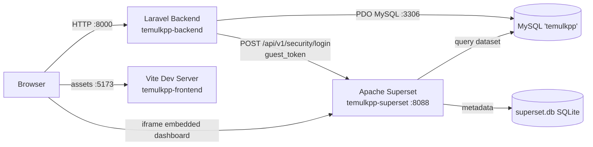
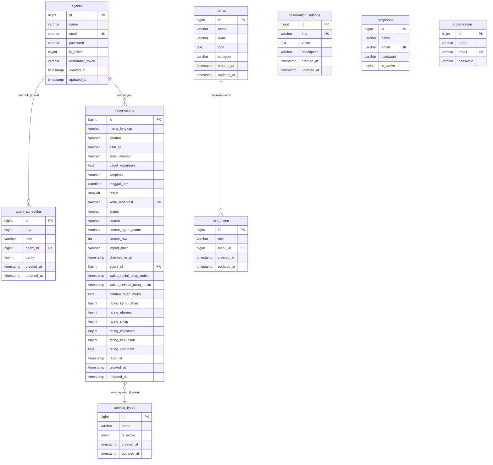
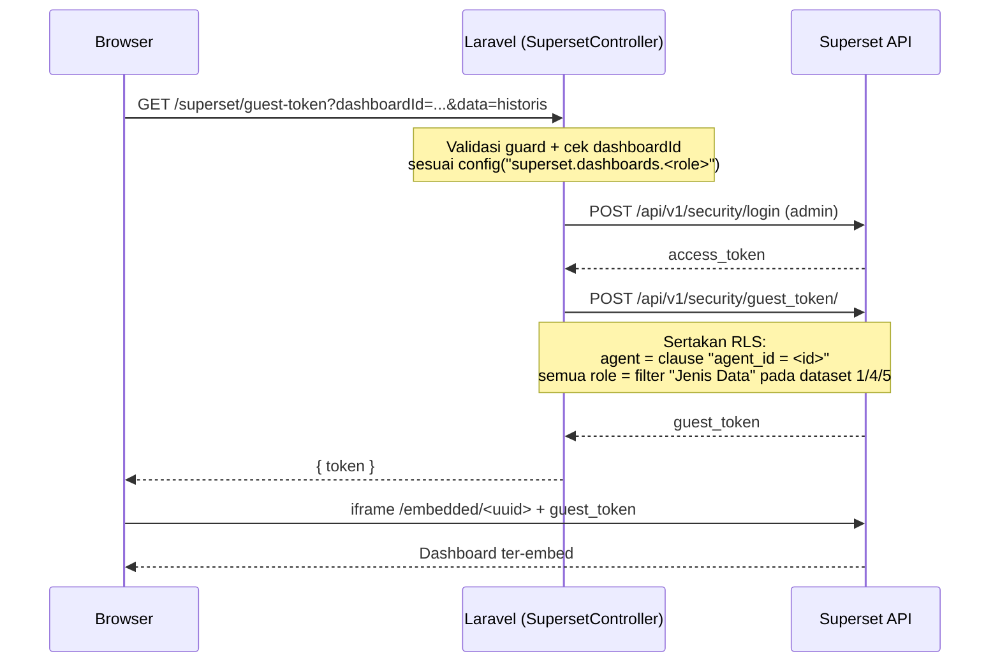
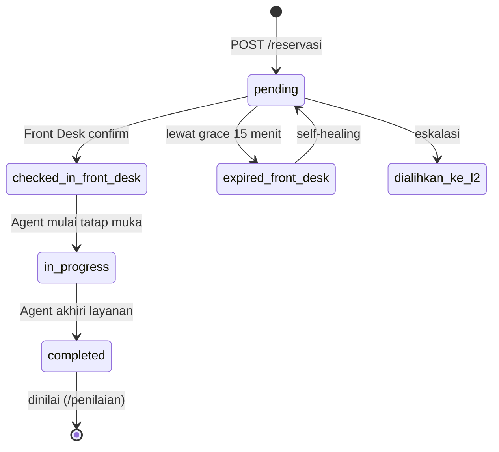

# Dokumentasi Sistem TemuLKPP

> Dokumen ini menjelaskan arsitektur, alur bisnis, endpoint, integrasi, dan
> **struktur database beserta relasi antar tabel** pada aplikasi TemuLKPP.
>
> Terakhir diperbarui: November 2026

---

## Daftar Isi

1. [Gambaran Umum](#1-gambaran-umum)
2. [Arsitektur & Stack](#2-arsitektur--stack)
3. [Struktur Direktori](#3-struktur-direktori)
4. [Autentikasi (3 Guard Terpisah)](#4-autentikasi-3-guard-terpisah)
5. [Otorisasi Berbasis Menu](#5-otorisasi-berbasis-menu)
6. [Alur Bisnis Reservasi](#6-alur-bisnis-reservasi)
7. [Pengaturan Slot & Layanan](#7-pengaturan-slot--layanan)
8. [Endpoint / Rute Lengkap](#8-endpoint--rute-lengkap)
9. [Database](#9-database)
   - [9.1 Daftar Tabel](#91-daftar-tabel)
   - [9.2 Relasi Antar Tabel (ERD)](#92-relasi-antar-tabel-erd)
   - [9.3 Skema Detail Tiap Tabel](#93-skiem-detail-tiap-tabel)
   - [9.4 Tabel Tanpa Relasi (Infrastruktur)](#94-tabel-tanpa-relasi-infrastruktur)
   - [9.5 Matriks Relasi](#95-matriks-relasi)
10. [Integrasi Apache Superset (Dashboard)](#10-integrasi-apache-superset-dashboard)
11. [Konfigurasi & Environment](#11-konfigurasi--environment)
12. [Deployment dengan Docker](#12-deployment-dengan-docker)
13. [Catatan Teknis & Titik Rawan](#13-catatan-teknis--titik-rawan)

---

## 1. Gambaran Umum

**TemuLKPP** adalah aplikasi reservasi layanan tatap muka LKPP. Pengguna
(masyarakat/institusi) mengajukan reservasi konsultasi, Front Desk melakukan
check-in tanpa login, Agent menangani layanan, Pimpinan memantau performa, dan
Superadmin mengelola seluruh master data serta perizinan menu.

### Peran Pengguna

| Peran | Login | Guard | Fungsi Utama |
|---|---|---|---|
| **Publik / Tamu** | Tidak | – | Membuat reservasi, reschedule, penilaian, konfirmasi tiket |
| **Front Desk** | Tidak | – | Check-in berdasarkan `kode_reservasi` |
| **Agent** | Ya | `agent` | Menangani layanan, jadwal, meeting tatap muka, upload bukti |
| **Pimpinan** | Ya | `pimpinan` | Monitoring layanan, laporan, performa agent, dashboard Superset |
| **Superadmin** | Ya | `superadmin` | Master data agent/pimpinan, perizinan menu, pengaturan reservasi, laporan |

---

## 2. Arsitektur & Stack

Satu repo berisi dua stack terpisah:

| Komponen | Teknologi | Port |
|---|---|---|
| Aplikasi web (`web/`) | Laravel 13, PHP 8.3, Blade, Vite, Tailwind CSS / Flowbite | `127.0.0.1:8000` (backend Apache) |
| Dev asset server (`web/frontend`) | Vite dev server | `127.0.0.1:5173` |
| Analytics (`apache/`) | Apache Superset 6.1.0 (Docker), metadata SQLite | `127.0.0.1:8088` |
| Database | MySQL 8 (berjalan di **host Windows**), diakses container via `host.docker.internal:3306` | `3306` |

### Diagram Arsitektur



### Integrasi Superset

Superset di-embed ke halaman dashboard tiap peran memakai
`@superset-ui/embed-sdk` dengan pola **guest token + RLS (Row Level Security)**.

---

## 3. Struktur Direktori

```
temulkpp-website/
├── web/                      # Aplikasi Laravel
│   ├── app/
│   │   ├── Http/
│   │   │   ├── Controllers/
│   │   │   │   ├── Agents/            # Dashboard, Meeting, Schedule, ServiceDetail, TicketVerification
│   │   │   │   ├── Auth/              # LoginController (guard gabungan)
│   │   │   │   ├── FrontDesk/         # ReservationCheckInController
│   │   │   │   ├── Pimpinan/           # DashboardController
│   │   │   │   ├── Superadmin/         # ReservationSettingController
│   │   │   │   ├── Users/              # Reservasi, AturUlangJadwal, Penilaian, Kontak, TentangKami
│   │   │   │   ├── SuperadminController.php
│   │   │   │   └── SupersetController.php
│   │   │   └── Middleware/
│   │   │       ├── EnsureMenuPermission.php   # otorisasi menu:<role>
│   │   │       ├── EnsureAgentUser.php
│   │   │       └── ResolveTabAuth.php
│   │   └── Models/           # Agent, AgentSchedule, Menu, Pimpinan, Reservation,
│   │                         # ReservationSetting, RoleMenu, ServiceType, Superadmin, User
│   ├── config/               # auth.php, superset.php, dll.
│   ├── database/seeders/     # MenuSeeder, SuperadminSeeder, dll.
│   ├── resources/views/      # Blade (layouts/, partials/, roles/<peran>/)
│   ├── routes/web.php        # seluruh route HTTP
│   └── .env.docker           # konfigurasi yang dipakai container
├── apache/                   # Superset via Docker Compose
│   ├── docker-compose.yml
│   ├── superset_config.py    # feature flag, CSP, guest token, RLS
│   ├── add_pimpinan_charts.py, add_triwulan_filter.py, ...  # provisioning idempoten
│   └── superset-data/superset.db
└── .serena/memories/         # catatan arsitektur proyek
```

---

## 4. Autentikasi (3 Guard Terpisah)

Didefinisikan di `web/config/auth.php`. Tabel pengguna **tidak disatukan** —
tiap peran punya tabel dan model sendiri:

| Guard | Provider | Model | Tabel |
|---|---|---|---|
| `web` | `users` | `App\Models\User` | `users` (bazar Laravel bawaan, tidak dipakai aktif) |
| `agent` | `agents` | `App\Models\Agent` | `agents` |
| `pimpinan` | `pimpinans` | `App\Models\Pimpinan` | `pimpinans` |
| `superadmin` | `superadmins` | `App\Models\Superadmin` | `superadmins` |

Poin penting:

- Route memakai guard eksplisit: `auth:agent`, `auth:pimpinan`, `auth:superadmin`.
- **Satu browser boleh login beberapa aktor sekaligus** (session tiap guard
  terpisah), sehingga halaman login tidak perlu logout dulu.
- **Front desk tanpa login** (`/front-desk`): murni identifikasi lewat
  `kode_reservasi`.
- **Rute publik tanpa login**: `/reservasi`, `/atur-ulang-jadwal`,
  `/penilaian`, `/agent/konfirmasi-tiket`, `/auth/login`.
- Cookie session: `samesite=lax`, `httponly`, `secure=false` (dev lokal).

---

## 5. Otorisasi Berbasis Menu

Middleware `EnsureMenuPermission` (`menu:<role>`) mengecek tabel `menus` +
`role_menu`. Route hanya boleh diakses bila role punya izin atas route tersebut.

```php
// pola pencocokan (web/app/Http/Middleware/EnsureMenuPermission.php)
$menuRoute === $routeName
|| Str::startsWith($routeName, Str::beforeLast($menuRoute, '.') . '.')
```

Artinya: grant pada route induk `superadmin.master-agent` juga membuka
`superadmin.master-agent.store`, `.update`, dst.

Pengelolaan izin dilakukan lewat UI: **Superadmin → Perizinan Menu**
(`POST /superadmin/perizinan`).

---

## 6. Alur Bisnis Reservasi

### Lifecycle Status

```
pending ──check-in Front Desk──▶ checked_in_front_desk ──▶ in_progress ──▶ completed
   │
   ├──lewat grace 15 menit──▶ expired_front_desk ──(self-healing)──▶ pending
   │
   └──escalation────────────▶ dialihkan_ke_l2
```

Label tampilan (`Reservation::getStatusLabelAttribute`):

| Value | Label |
|---|---|
| `pending` | Menunggu |
| `checked_in_front_desk` | Sudah Check-In |
| `in_progress` | Sedang Berlangsung |
| `completed` | Selesai |
| `expired_front_desk` | Kedaluwarsa |
| `dialihkan_ke_l2` | Dialihkan ke L2 |

### Aturan Front Desk

- Grace period **15 menit** setelah `tanggal_jam`.
- Check-in wajib **hari yang sama**.
- Self-healing: reservasi lewat grace otomatis `expired_front_desk` lalu bisa
  kembali `pending`.

### Penugasan Agent Otomatis

Saat reservasi dibuat, agent ditugaskan otomatis dengan urutan bobot:

1. Minimalkan jumlah reservasi pada hari yang sama.
2. Minimalkan jumlah reservasi aktif.
3. Tie-break deterministik: seed `crc32` (konsisten antar request).

### Slot Konsultasi

Dari `reservation_settings` (lihat §7): Senin–Kamis, pagi 08:00–11:20, siang
13:00–15:40, durasi 40 menit, maksimal 7 reservasi per slot.

### Mode "Data Uji" vs "Historis"

Kontrol `?data=uji` pada halaman dashboard menyaring seluruh isi dashboard.
Di database ditandai kolom `source` pada `reservations`:

- `data-uji` → data uji (>= 2026-10-01)
- `lkpp_gsheet` / lainnya → data historis

Pembatasan berlaku juga untuk Superset lewat klausul RLS pada guest token.

---

## 7. Pengaturan Slot & Layanan

### Tabel `reservation_settings` (key/value)

| Key | Default | Keterangan |
|---|---|---|
| `available_days` | `[1,2,3,4]` | Hari buka (Senin–Kamis), JSON array |
| `max_reservations_per_slot` | `7` | Kapasitas maksimal per slot |
| `consultation_duration_minutes` | `40` | Durasi konsultasi (menit) |
| `morning_start` / `morning_end` | `08:00` / `11:20` | Sesi pagi |
| `afternoon_start` / `afternoon_end` | `13:00` / `15:40` | Sesi siang |

### Tabel `service_types`

Daftar jenis layanan dengan flag `is_active`. Dikelola di
`Superadmin → Pengaturan Reservasi` (CRUD + toggle).

---

## 8. Endpoint / Rute Lengkap

Semua route ada di `web/routes/web.php`.

### Publik (tanpa login)

| Method | URI | Nama | Controller |
|---|---|---|---|
| GET | `/` | – | redirect → `/reservasi` |
| GET | `/reservasi` | `reservasi` | `Users\ReservasiController@index` |
| POST | `/reservasi` | `reservasi.store` | `Users\ReservasiController@store` |
| GET | `/reservasi/{kodeReservasi}/download` | `reservasi.download` | `Users\ReservasiController@download` |
| GET | `/atur-ulang-jadwal` | `atur-ulang-jadwal` | `Users\AturUlangJadwalController@index` |
| PUT | `/atur-ulang-jadwal/{kodeReservasi}` | `atur-ulang-jadwal.update` | `Users\AturUlangJadwalController@update` |
| DELETE | `/atur-ulang-jadwal/{kodeReservasi}` | `atur-ulang-jadwal.destroy` | `Users\AturUlangJadwalController@destroy` |
| GET | `/penilaian` | `penilaian` | `Users\PenilaianController@index` |
| GET | `/penilaian/{kodeReservasi}` | `penilaian.show` | `Users\PenilaianController@show` |
| POST | `/penilaian/{kodeReservasi}` | `penilaian.store` | `Users\PenilaianController@store` |

### Front Desk (tanpa login)

| Method | URI | Nama | Controller |
|---|---|---|---|
| GET | `/front-desk` | `front-desk` | `FrontDesk\ReservationCheckInController@index` |
| PATCH | `/front-desk/{kodeReservasi}/confirm` | `front-desk.confirm` | `FrontDesk\ReservationCheckInController@confirm` |

### Auth

| Method | URI | Nama |
|---|---|---|
| GET | `/auth/login` | `login` |
| POST | `/auth/login` | `login.store` |
| POST | `/auth/logout` | `logout` |

### Agent (`auth:agent`, prefix `/agent`)

| Method | URI | Nama |
|---|---|---|
| GET | `/agent/dashboard` | `agent.dashboard` |
| GET | `/agent/jadwal` | `agent.jadwal` |
| GET | `/agent/detail-layanan` | `agent.detail-layanan` |
| GET | `/agent/file/{reservation}/{type}` | `agent.service.download` |
| GET | `/agent/tatap-muka/{kodeReservasi}` | `agent.tatap-muka.show` |
| POST | `/agent/tatap-muka/{kodeReservasi}/start` | `agent.tatap-muka.start` |
| POST | `/agent/tatap-muka/{kodeReservasi}/end` | `agent.tatap-muka.end` |

### Rute Publik Agent Tools

| Method | URI | Nama |
|---|---|---|
| GET | `/agent/konfirmasi-tiket` | `agent.konfirmasi-tiket` |

### Pimpinan (`auth:pimpinan`, prefix `/pimpinan`)

| Method | URI | Nama |
|---|---|---|
| GET | `/pimpinan/dashboard` | `pimpinan.dashboard` |
| GET | `/pimpinan/layanan-selesai` | `pimpinan.layanan-selesai` |
| GET | `/pimpinan/layanan-berjalan` | `pimpinan.layanan-berjalan` |
| GET | `/pimpinan/performa-agent` | `pimpinan.performa-agent` |
| GET | `/pimpinan/laporan` | `pimpinan.laporan` |
| GET | `/pimpinan/laporan/cetak` | `pimpinan.laporan.cetak` |

### Superadmin (`auth:superadmin`, prefix `/superadmin`)

| Method | URI | Nama |
|---|---|---|
| GET | `/superadmin/dashboard` | `superadmin.dashboard` |
| GET | `/superadmin/perizinan` | `superadmin.permissions` |
| POST | `/superadmin/perizinan` | `superadmin.permissions.update` |
| GET/POST | `/superadmin/master-data/agent` | `superadmin.master-agent` / `.store` |
| POST | `/superadmin/master-data/agent/schedules` | `superadmin.master-agent.schedules.update` |
| POST | `/superadmin/master-data/agent/schedules/generate` | `superadmin.master-agent.schedules.generate` |
| PUT | `/superadmin/master-data/agent/{agent}` | `superadmin.master-agent.update` |
| PATCH | `/superadmin/master-data/agent/{agent}/toggle-status` | `superadmin.master-agent.toggle-status` |
| GET/POST | `/superadmin/master-data/pimpinan` | `superadmin.master-pimpinan` / `.store` |
| PUT | `/superadmin/master-data/pimpinan/{pimpinan}` | `superadmin.master-pimpinan.update` |
| PATCH | `/superadmin/master-data/pimpinan/{pimpinan}/toggle-status` | `superadmin.master-pimpinan.toggle-status` |
| GET | `/superadmin/layanan-selesai` | `superadmin.layanan-selesai` |
| GET | `/superadmin/layanan-berjalan` | `superadmin.layanan-berjalan` |
| GET | `/superadmin/performa-agent` | `superadmin.performa-agent` |
| GET | `/superadmin/laporan` | `superadmin.laporan` |
| GET | `/superadmin/laporan/cetak` | `superadmin.laporan.cetak` |
| GET/POST | `/superadmin/pengaturan-reservasi` | `superadmin.reservation-settings` / `.update` |
| POST | `/superadmin/pengaturan-reservasi/reset` | `superadmin.reservation-settings.reset` |
| POST | `/superadmin/service-types` | `superadmin.service-types.store` |
| PATCH | `/superadmin/service-types/{serviceType}/toggle` | `superadmin.service-types.toggle` |
| DELETE | `/superadmin/service-types/{serviceType}` | `superadmin.service-types.destroy` |

### Superset (butuh login salah satu guard)

| Method | URI | Nama | Keterangan |
|---|---|---|---|
| GET | `/superset/guest-token` | `superset.guest-token` | `auth:agent,pimpinan,superadmin` |

---

## 9. Database

Database MySQL `temulkpp`, collation `utf8mb4_unicode_ci` (beberapa tabel
`utf8mb4_general_ci`). Total **13 tabel**.

### 9.1 Daftar Tabel

| # | Tabel | Baris | Peran |
|---|---|---:|---|
| 1 | `reservations` | 2.768 | **Inti** — data reservasi & penilaian |
| 2 | `agent_schedules` | 616 | Jadwal kerja agent per hari/jam/paritas |
| 3 | `agents` | 16 | Akun agent (guard `agent`) |
| 4 | `menus` | 17 | Master menu navigasi |
| 5 | `role_menu` | 17 | Izin role ↔ menu |
| 6 | `pimpinans` | 3 | Akun pimpinan (guard `pimpinan`) |
| 7 | `reservation_settings` | 7 | Konfigurasi slot (key/value) |
| 8 | `service_types` | 4 | Master jenis layanan |
| 9 | `superadmins` | 1 | Akun superadmin (guard `superadmin`) |
| 10 | `sessions` | 33 | Session Laravel |
| 11 | `migrations` | 30 | Riwayat migrasi |
| 12 | `cache` | 0 | Cache Laravel |
| 13 | `cache_locks` | 0 | Lock cache |

---

### 9.2 Relasi Antar Tabel (ERD)



#### Relasi yang dieksplisitkan di level database (Foreign Key)

| # | Relasi | Kolom FK | Ke Target | Tipe | ON DELETE* |
|---|---|---|---|---|---|
| 1 | `agent_schedules` → `agents` | `agent_schedules.agent_id` | `agents.id` | **1 : N** | Restrict/Cascade (migrasi Laravel) |
| 2 | `reservations` → `agents` | `reservations.agent_id` | `agents.id` | **1 : N (nullable)** | Restrict/Cascade |
| 3 | `role_menu` → `menus` | `role_menu.menu_id` | `menus.id` | **1 : N** | Restrict/Cascade |

> \* Semua FK dibuat oleh migrasi Laravel (`*_foreign`), tanpa `ON DELETE`
> eksplisit sehingga memakai perilaku default `RESTRICT`.
> Kolom `reservations.agent_id` **nullable** — reservasi historis impor bisa
> belum punya agent.

#### Relasi logis (tanpa Foreign Key)

| Relasi | Cara | Keterangan |
|---|---|---|
| `reservations.jenis_layanan` → `service_types.name` | pencocokan nama | Kolom `varchar(100)`, **bukan FK**. Berhati-hatilah bila rename service type. |
| `role_menu.role` → guard (`agent`/`pimpinan`/`superadmin`) | string role | Nilai `'agent'`, `'pimpinan'`, `'superadmin'` sesuai `menu:<role>` |
| `reservations.source` → kategori data | enum string | `'data-uji'` / `'lkpp_gsheet'` (filter historis vs uji) |
| `agents` / `pimpinans` / `superadmins` | **tidak saling terhubung** | Tiga entitas guard terpisah, tidak ada tabel `users` induk |

---

### 9.3 Skema Detail Tiap Tabel

#### `agents` — Akun Agent

| Kolom | Tipe | Null | Key | Default | Keterangan |
|---|---|---|---|---|---|
| `id` | bigint(20) unsigned | NO | **PRI** | auto_increment | |
| `name` | varchar(255) | NO | | | Nama agent |
| `email` | varchar(255) | NO | **UNI** | | Login agent |
| `password` | varchar(255) | NO | | | bcrypt hash |
| `is_active` | tinyint(1) | NO | | `1` | Status aktif (toggle oleh superadmin) |
| `remember_token` | varchar(100) | YES | | | |
| `created_at` / `updated_at` | timestamp | YES | | | |

**Relasi:**
- `agents 1 ──< agent_schedules N` (FK `agent_schedules.agent_id`)
- `agents 1 ──< reservations N` (FK `reservations.agent_id`, nullable)

---

#### `agent_schedules` — Jadwal Kerja Agent

| Kolom | Tipe | Null | Key | Default | Keterangan |
|---|---|---|---|---|---|
| `id` | bigint(20) unsigned | NO | **PRI** | auto_increment | |
| `day` | tinyint(3) unsigned | NO | MUL | | 1=Senin … 7=Minggu |
| `time` | varchar(5) | NO | | | Format `HH:MM` |
| `agent_id` | bigint(20) unsigned | NO | **MUL/FK** | | → `agents.id` |
| `parity` | tinyint(3) unsigned | NO | | `0` | Paritas minggu (genap/ganjil) |
| `created_at` / `updated_at` | timestamp | YES | | | |

**Index:**
- `UNIQUE (day, time, parity, agent_id)` — cegah jadwal ganda
- `IDX (day, time, parity)` — pencarian slot
- `IDX (agent_id)` — FK index

**Relasi:** `agents 1 ──< agent_schedules N`

---

#### `reservations` — Data Reservasi (Tabel Inti)

| Kolom | Tipe | Null | Key | Default | Keterangan |
|---|---|---|---|---|---|
| `id` | bigint(20) unsigned | NO | **PRI** | auto_increment | |
| `nama_lengkap` | varchar(50) | NO | | | Nama tamu |
| `jabatan` | varchar(100) | NO | | | |
| `asal_pt` | varchar(100) | NO | | | Asal instansi/perusahaan |
| `jenis_layanan` | varchar(100) | YES | | | **Logis** → `service_types.name` |
| `detail_keperluan` | text | NO | | | |
| `lampiran` | varchar(255) | YES | | | Path file lampiran |
| `tanggal_jam` | datetime | NO | | | Jadwal konsultasi |
| `tahun` | smallint(5) unsigned | YES | MUL | | Denormalisasi tahun (filter Superset) |
| `kode_reservasi` | varchar(255) | NO | **UNI** | | Kode tiket (identitas publik) |
| `status` | varchar(50) | NO | | `pending` | Lifecycle (lihat §6) |
| `source` | varchar(50) | YES | MUL | | `'data-uji'` / `'lkpp_gsheet'` |
| `source_agent_name` | varchar(100) | YES | | | Nama agent saat impor |
| `source_row` | int(10) unsigned | YES | | | Baris asal file impor |
| `import_hash` | varchar(64) | YES | | | `sha256` untuk dedup impor |
| `checked_in_at` | timestamp | YES | | | Waktu check-in front desk |
| `agent_id` | bigint(20) unsigned | YES | **MUL/FK** | | → `agents.id` (nullable) |
| `waktu_mulai_tatap_muka` | timestamp | YES | | | Mulai layanan |
| `waktu_selesai_tatap_muka` | timestamp | YES | | | Selesai layanan |
| `catatan_tatap_muka` | text | YES | | | Catatan agent |
| `rating_kemudahan` | tinyint(3) unsigned | YES | | | Skor 1–5 |
| `rating_efisiensi` | tinyint(3) unsigned | YES | | | Skor 1–5 |
| `rating_sikap` | tinyint(3) unsigned | YES | | | Skor 1–5 |
| `rating_kejelasan` | tinyint(3) unsigned | YES | | | Skor 1–5 |
| `rating_kepuasan` | tinyint(3) unsigned | YES | | | Skor 1–5 |
| `rating_comment` | text | YES | | | Komentar tamu |
| `rated_at` | timestamp | YES | | | Waktu penilaian |
| `created_at` / `updated_at` | timestamp | YES | | | |

**Index:**
- `UNIQUE (kode_reservasi)`
- `IDX (agent_id)`, `IDX (source)`, `IDX (tahun)`

**Relasi:**
- `reservations N ──> agents 1` (FK `agent_id`, nullable)
- `reservations N . . .> service_types 1` (logis via `jenis_layanan`)

**Catatan model (`Reservation.php`):**
- Global scope `only_test_data` menyaring data berdasarkan `source`.
- Scope `jenisData()` untuk mode historis/uji.
- Accessor: `average_rating`, `has_complete_rating`, `status_label`.
- **Tidak ada SoftDeletes** — penghapusan bersifat permanen.

---

#### `menus` — Master Menu

| Kolom | Tipe | Null | Key | Default | Keterangan |
|---|---|---|---|---|---|
| `id` | bigint(20) unsigned | NO | **PRI** | auto_increment | |
| `name` | varchar(255) | NO | | | Label menu |
| `route` | varchar(255) | NO | | | Route name, mis. `superadmin.master-agent` |
| `icon` | text | YES | | | SVG icon |
| `category` | varchar(255) | YES | | | Pengelompokan sidebar |
| `created_at` / `updated_at` | timestamp | YES | | | |

**Relasi:** `menus 1 ──< role_menu N`

---

#### `role_menu` — Izin Role ↔ Menu (Pivot)

| Kolom | Tipe | Null | Key | Default | Keterangan |
|---|---|---|---|---|---|
| `id` | bigint(20) unsigned | NO | **PRI** | auto_increment | |
| `role` | varchar(255) | NO | | | `'agent'` / `'pimpinan'` / `'superadmin'` |
| `menu_id` | bigint(20) unsigned | NO | **MUL/FK** | | → `menus.id` |
| `created_at` / `updated_at` | timestamp | YES | | | |

**Relasi:** `role_menu N ──> menus 1`

---

#### `service_types` — Master Jenis Layanan

| Kolom | Tipe | Null | Key | Default | Keterangan |
|---|---|---|---|---|---|
| `id` | bigint(20) unsigned | NO | **PRI** | auto_increment | |
| `name` | varchar(255) | NO | | | Nama layanan |
| `is_active` | tinyint(1) | NO | | `1` | Ditawarkan di form reservasi |
| `created_at` / `updated_at` | timestamp | YES | | | |

**Relasi logis:** dirujuk oleh `reservations.jenis_layanan` (tanpa FK).

---

#### `reservation_settings` — Konfigurasi Slot (Key/Value)

| Kolom | Tipe | Null | Key | Default | Keterangan |
|---|---|---|---|---|---|
| `id` | bigint(20) unsigned | NO | **PRI** | auto_increment | |
| `key` | varchar(255) | NO | **UNI** | | Nama pengaturan |
| `value` | text | YES | | | Nilai (kadang JSON) |
| `description` | varchar(255) | YES | | | Keterangan |
| `created_at` / `updated_at` | timestamp | YES | | | |

**Relasi:** tidak ada (tabel konfigurasi mandiri).

---

#### `pimpinans` — Akun Pimpinan

| Kolom | Tipe | Null | Key | Default |
|---|---|---|---|---|
| `id` | bigint(20) unsigned | NO | **PRI** | auto_increment |
| `name` | varchar(255) | NO | | |
| `email` | varchar(255) | NO | **UNI** | |
| `password` | varchar(255) | NO | | |
| `is_active` | tinyint(1) | NO | | `1` |
| `remember_token` | varchar(100) | YES | | |
| `created_at` / `updated_at` | timestamp | YES | | |

**Relasi:** tidak ada FK.

---

#### `superadmins` — Akun Superadmin

| Kolom | Tipe | Null | Key | Default |
|---|---|---|---|---|
| `id` | bigint(20) unsigned | NO | **PRI** | auto_increment |
| `name` | varchar(255) | NO | | |
| `email` | varchar(255) | NO | **UNI** | |
| `password` | varchar(255) | NO | | |
| `remember_token` | varchar(100) | YES | | |
| `created_at` / `updated_at` | timestamp | YES | | |

**Relasi:** tidak ada FK. Dari seeder: `superadmin@temulkpp.com` / `password`.

---

### 9.4 Tabel Tanpa Relasi (Infrastruktur)

| Tabel | Primary Key | Kolom | Fungsi |
|---|---|---|---|
| `sessions` | `id` (varchar) | `user_id`, `ip_address`, `user_agent`, `payload`, `last_activity` | Session Laravel (`SESSION_DRIVER=database`). `user_id` **tanpa FK** — nilainya ID dari guard yang sedang login (bersifat polimorfik). |
| `cache` | `key` | `value`, `expiration` | Cache Laravel (`CACHE_STORE=database`) |
| `cache_locks` | `key` | `owner`, `expiration` | Locking cache |
| `migrations` | `id` | `migration`, `batch` | Riwayat migrasi |

---

### 9.5 Matriks Relasi

Ringkasan seluruh hubungan antar tabel:

```
agents ──┬──< agent_schedules        (FK agent_schedules.agent_id = agents.id)        1 : N
         └──< reservations           (FK reservations.agent_id    = agents.id)        1 : N (nullable)

menus ──────< role_menu              (FK role_menu.menu_id        = menus.id)         1 : N

service_types <··· reservations       (logis, via reservations.jenis_layanan)         1 : N*

reservation_settings   — mandiri (key/value konfigurasi)
pimpinans              — mandiri (guard terpisah, tanpa FK)
superadmins            — mandiri (guard terpisah, tanpa FK)
sessions / cache / cache_locks / migrations — infrastruktur, tanpa relasi
```

**Keterangan:**
- `1 : N` — satu agent punya banyak jadwal/reservasi.
- `1 : N (nullable)` — reservasi boleh tanpa agent (data historis impor).
- `1 : N*` — relasi logis berbasis nama, **bukan FK**; jaga konsistensi nilai.

---

## 10. Integrasi Apache Superset (Dashboard)

### Alur Guest Token



### Konfigurasi

| Item | Nilai | Sumber |
|---|---|---|
| Superadmin dashboard UUID | `da1f9b3b-8911-4eb7-a7eb-9df03b41bb1c` | `SUPERSET_SUPERADMIN_DASHBOARD_ID` |
| Pimpinan dashboard UUID | `1a2b3c4d-5e6f-7a8b-9c0d-1e2f3a4b5c6d` | `SUPERSET_PIMPINAN_DASHBOARD_ID` |
| Agent dashboard UUID | `dbd88673-b705-40cc-8fa0-b8b8a26e9afd` | `SUPERSET_AGENT_DASHBOARD_ID` |
| Domain publik (iframe) | `http://localhost:8088` | `SUPERSET_PUBLIC_URL` |
| Domain internal (server) | `http://host.docker.internal:8088` | `SUPERSET_INTERNAL_URL` |

### Embed SDK

Halaman dashboard Blade memuat `https://unpkg.com/@superset-ui/embed-sdk@0.2.0`
lalu memanggil `supersetEmbeddedSdk.embedDashboard({...})` dengan
`fetchGuestToken` yang menembak `route('superset.guest-token')`.

### Klausul RLS "Jenis Data"

```php
$jenisClause = $jenisUji
    ? "tanggal_jam >= '2026-10-01'"
    : "(tanggal_jam < '2026-10-01' OR tanggal_jam IS NULL)";
```

Diterapkan **hanya ke dataset yang punya kolom `tanggal_jam`** (dataset id 1, 4, 5).
Dataset `agents` (id 2) dan `virtual_roles` (id 3) tidak boleh kena filter
(akan error `Unknown column 'tanggal_jam'`).

### Konfigurasi Superset (`apache/superset_config.py`)

| Konfigurasi | Nilai | Keterangan |
|---|---|---|
| `FEATURE_FLAGS.EMBEDDED_SUPERSET` | `True` | Wajib untuk embed |
| `GUEST_ROLE_NAME` | `Admin` | Role untuk guest token |
| `ENABLE_ROW_LEVEL_SECURITY` | `True` | Aktifkan RLS |
| `WTF_CSRF_ENABLED` | `False` | Longgar untuk dev |
| `PREVENT_UNSAFE_DB_CONNECTIONS` | `False` | Longgar untuk dev |
| `CORS_OPTIONS.origins` | `http://localhost:8000` | Asal diizinkan |
| `TALISMAN frame-ancestors` | `http://localhost:8000` | **Hanya origin ini boleh membingkai dashboard** |
| `CUSTOM_SECURITY_MANAGER` | `CustomSecurityManager` | Menangani "Guest user cannot modify chart payload" |

### Provisioning Otomatis (boot container)

```
superset db upgrade
  → python /app/sync_mysql_connection.py      # sinkron URI MySQL dari MYSQL_URI
  → superset init                             # role & permission
  → python /app/add_pimpinan_charts.py        # dataset + chart (idempoten)
  → python /app/add_triwulan_filter.py         # filter "Tahun"/"Triwulan" (idempoten)
  → python /app/add_jenis_data_filter.py       # filter "Jenis Data"
```

### Dashboard yang tersedia di Superset

| ID | Judul | UUID | Embedded? |
|---:|---|---|---|
| 2 | Dashboard Agent Performance | `dbd88673-…9afd` | ✅ |
| 3 | Dashboard Superadmin Overview | `da1f9b3b-…bb1c` | ✅ |
| 4 | Dashboard Pimpinan Overview | `1a2b3c4d-…5c6d` | ✅ |
| 5 | Dashboard Rating | `fea3779a-…7b74` | ❌ |

### Troubleshooting embed

| Gejala | Penyebab umum | Solusi |
|---|---|---|
| iframe kosong, console `403` | Halaman dibuka dari origin selain `http://localhost:8000` (mis. `127.0.0.1:8000`) — dicek `allowed_domains` + `frame-ancestors` | Buka site selalu dari `http://localhost:8000`, atau tambahkan origin lain di `embedded_dashboards.allowed_domains` + `TALISMAN_CONFIG.frame-ancestors` |
| `Gagal memuat grafik` + cURL error 7/52 | Container backend tidak bisa capai Superset | Pastikan container Superset up, `SUPERSET_INTERNAL_URL=http://host.docker.internal:8088` |
| Grafik kosong padahal embed jalan | Klausul RLS "Jenis Data" menyaring semua baris | Cek nilai `source` pada `reservations` |
| `Invalid decryption key` | `SUPERSET_SECRET_KEY` berubah | Kembalikan key asli di `apache/.env.docker` |

---

## 11. Konfigurasi & Environment

### `web/.env.docker` (dipakai container backend)

```dotenv
APP_NAME=Laravel
APP_ENV=local
APP_URL=http://localhost:8000

DB_CONNECTION=mysql
DB_HOST=host.docker.internal
DB_PORT=3306
DB_DATABASE=temulkpp
DB_USERNAME=root
DB_PASSWORD=

SESSION_DRIVER=database
SESSION_LIFETIME=120
CACHE_STORE=database
QUEUE_CONNECTION=database

# Apache Superset
SUPERSET_URL=http://host.docker.internal:8088
SUPERSET_INTERNAL_URL=http://host.docker.internal:8088
SUPERSET_PUBLIC_URL=http://localhost:8088
SUPERSET_ADMIN_USERNAME=admin
SUPERSET_ADMIN_PASSWORD=admin
SUPERSET_AGENT_DASHBOARD_ID=dbd88673-b705-40cc-8fa0-b8b8a26e9afd
SUPERSET_SUPERADMIN_DASHBOARD_ID=da1f9b3b-8911-4eb7-a7eb-9df03b41bb1c
SUPERSET_PIMPINAN_DASHBOARD_ID=1a2b3c4d-5e6f-7a8b-9c0d-1e2f3a4b5c6d
```

> **Catatan:** dari host, backend juga bisa dijalankan tanpa Docker memakai
> `SUPERSET_URL=http://localhost:8088`. File `.env` di root `web/` tidak ada —
> container memakai `.env.docker` via `env_file`.

### `apache/.env.docker`

```dotenv
SUPERSET_SECRET_KEY=<harus sama dengan saat metadata dibuat>
GUEST_TOKEN_JWT_SECRET=<rahasia JWT guest token>
SUPERSET_ADMIN_USERNAME=admin
SUPERSET_ADMIN_PASSWORD=admin123
MYSQL_URI=mysql+pymysql://root:@host.docker.internal:3306/temulkpp
LARAVEL_URL=http://host.docker.internal:8000
SUPERSET_URL=http://localhost:8088
CORS_ORIGINS=http://localhost:8000
```

---

## 12. Deployment dengan Docker

### Perintah Umum

```bash
# Backend + frontend
cd web
docker compose up -d --build

# Superset
cd apache
docker compose up -d
docker compose logs -f superset
```

### Container

| Nama | Image | Port | Healthcheck |
|---|---|---|---|
| `temulkpp-backend` | `temulkpp-backend:1.0` | `127.0.0.1:8000→80` | `curl -fsS http://127.0.0.1/up` |
| `temulkpp-frontend` | `temulkpp-frontend:1.0` | `127.0.0.1:5173→5173` | – (depends_on backend sehat) |
| `temulkpp-superset` | `temulkpp-superset:6.1.0` | `127.0.0.1:8088→8088` | healthcheck bawaan |

### Batasan Resource

| Container | mem_limit | cpus |
|---|---|---|
| backend | 768 MB | 1.0 |
| frontend | 384 MB | 0.75 |

### Volume Bind-mount (backend)

`app`, `bootstrap`, `config`, `resources`, `routes`, `public`, `storage`
di-mount dari host → edit kode tanpa rebuild image.

> **Windows + Vite:** bind mount tidak mengirim event inotify andal, jadi
> `vite.config.js` memakai `watch.usePolling: true` (interval 500 ms).
> Perubahan `resources/css/app.css` tetap butuh restart container frontend.

---

## 13. Catatan Teknis & Titik Rawan

| # | Temuan | Dampak | Saran |
|---|---|---|---|
| 1 | Kapasitas slot di `ReservasiController::store` **tanpa `lockForUpdate`** | Race condition → bisa melebihi `max_reservations_per_slot` | Bungkus pengecekan + insert dalam transaksi + lock baris |
| 2 | `MeetingController::show` (GET) punya **side effect update status** | Melanggar semantik GET, rawan CSRF/prefetch | Pindahkan ke route POST/PATCH |
| 3 | `AturUlangJadwalController::update` membuat baris baru + **hard delete** baris lama | `kode_reservasi` berubah, `agent_id` hilang | Pakai update in-place, atau pertahankan FK saat pindah jadwal |
| 4 | Selisih 7 jam `tanggal_jam` vs `waktu_mulai_tatap_muka` pada data historis (WIB vs UTC) | Filter tanggal bisa meleset | Normalisasi zona waktu saat impor / saat query |
| 5 | `Reservation` **tidak pakai SoftDeletes** | Data hapus permanen | Pertimbangkan soft delete + audit |
| 6 | `reservations.jenis_layanan` bukan FK ke `service_types` | Rename service type memutus konsistensi | Tambah FK berbasis nama atau pivot ID |
| 7 | `sessions.user_id` tanpa FK polimorfik | Query session harus tahu guard aktif | Documentasikan; tambahkan kolom `guard` bila perlu |
| 8 | Password default superadmin `password` (seeder) & admin Superset `admin/admin123` | Risiko keamanan bila ter-expose | Ganti di lingkungan non-lokal |
| 9 | `WTF_CSRF_ENABLED=False`, `PREVENT_UNSAFE_DB_CONNECTIONS=False` | Hanya aman untuk **dev lokal** | Matikan/mubah untuk produksi |
| 10 | Tabel staging `reservation_import_batches/rows` **tidak ada** di skema 13 tabel ini | Dokumen lain mungkin menyebutnya | Verifikasi bila fitur impor diaktifkan kembali |

---

## Lampiran A — Diagram Alur Reservasi



---

*Dokumen dibuat berdasarkan skema database aktual (13 tabel) dan kode sumber
`web/routes/web.php`, `web/config/*`, serta `apache/superset_config.py`.*
